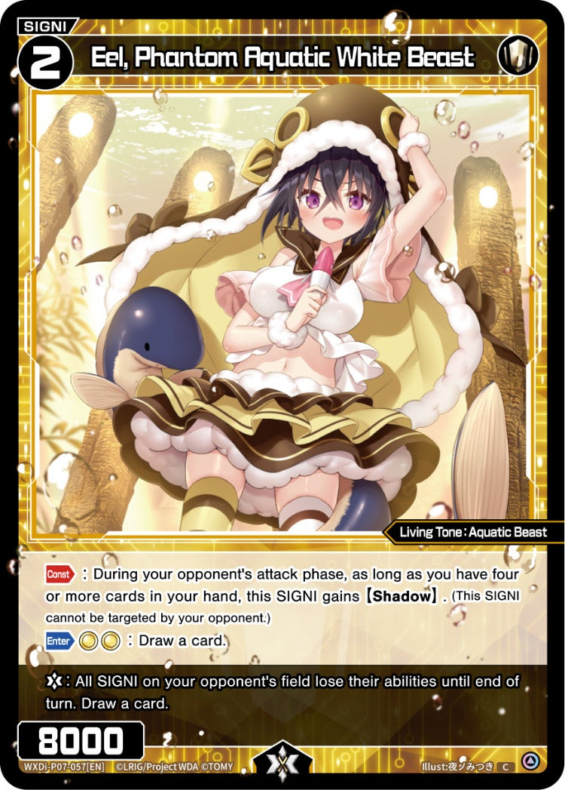

# Eel, Phantom Aquatic White Beast

## Thông tin lá

| Trường | Giá trị |
| --- | --- |
| Mã in | WXDi-P07-057[EN] |
| Set | WXDi-P07[EN] |
| Số thứ tự | 057 |
| Loại thẻ | SIGNI |
| Vị trí | Main Deck |
| Số bản | — (set booster, không áp dụng) |
| Màu | Trắng |
| Độ hiếm | C,C(P) |
| Minh họa | 夜ノみつき |
| Level | 2 |
| Limit | — |
| Power | 8000 |
| LRIG type / Class | Living Tone：Aquatic Beast |
| Team / Master | — |
| Cost | — |
| Grow cost | — |
| Use timing | — |
| Life Burst | Có |

## Card text chính thức

[Constant]: During your opponent's attack phase, as long as you have four or more cards in your hand, this SIGNI gains 【Shadow】. (This SIGNI cannot be targeted by your opponent.)
[Enter] {Coin Icon} {Coin Icon}: Draw a card.

## Power text / Life Burst

All SIGNI on your opponent's field lose their abilities until end of turn. Draw a card.

## Ghi chú minh họa
Artist: 夜ノみつき. Ảnh C được tải từ Card List tiếng Anh.

## FAQ chính thức

**Q. I trigger this SIGNI's Life Burst and all my opponent's SIGNI lose their abilities. Does the SIGNI that enters the opponent's field after resolved this Life Burst during that turn lose its abilities?**
A. No, it does not lose abilities. This effect only affects the SIGNI on your opponent's field at the time of Life Burst resolved.

## Ảnh biến thể

- [C(P)](../images/WXDi-P07-057P-EN.jpg)

## Nguồn
[Card List/FAQ chính thức](https://www.takaratomy.co.jp/products/en.wixoss/card/card.html?card_no=WXDi-P07-057%5BEN%5D ) · [Ảnh thẻ](https://www.takaratomy.co.jp/products/en.wixoss/card/thumb/WXDi-P07-057%5BEN%5D.jpg)
