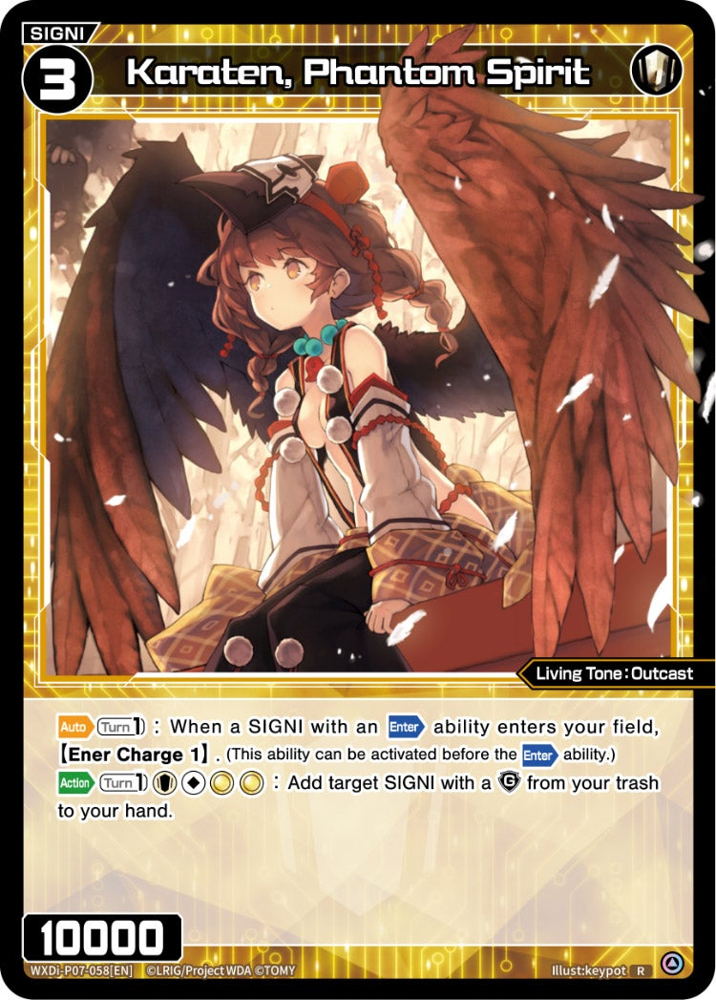

# Karaten, Phantom Spirit

## Thông tin lá

| Trường | Giá trị |
| --- | --- |
| Mã in | WXDi-P07-058[EN] |
| Set | WXDi-P07[EN] |
| Số thứ tự | 058 |
| Loại thẻ | SIGNI |
| Vị trí | Main Deck |
| Số bản | — (set booster, không áp dụng) |
| Màu | Trắng |
| Độ hiếm | R,R(P) |
| Minh họa | keypot |
| Level | 3 |
| Limit | — |
| Power | 10000 |
| LRIG type / Class | Living Tone：Outcast |
| Team / Master | — |
| Cost | — |
| Grow cost | — |
| Use timing | — |
| Life Burst | Không |

## Card text chính thức

[Auto] {1/Turn}: When a SIGNI with an [Enter] ability enters your field, 【Ener Charge 1】. (This ability can be activated before the [Enter] ability.)
[Action] {1/Turn} {White} {Colorless} {Coin Icon} {Coin Icon}: Add target SIGNI with a {Guard Icon} from your trash to your hand.

## Power text / Life Burst

—

## Ghi chú minh họa
Artist: keypot. Ảnh R được tải từ Card List tiếng Anh.

## FAQ chính thức

**Q. When a SIGNI with [Team Enter] ability enters my field, does this SIGNI's [Auto] ability trigger?**
A. Yes, the [Team Enter] ability is also the [Enter] ability, so it is triggered.

**Q. When I put a SIGNI with the [Enter] ability, which triggers first, its [Enter] ability or this SIGNI's [Auto] ability?**
A. Both will be abilities triggered by you, so you can resolve them one at a time in any order you wish.

## Ảnh biến thể

- [R(P)](../images/WXDi-P07-058P-EN.jpg)

## Nguồn
[Card List/FAQ chính thức](https://www.takaratomy.co.jp/products/en.wixoss/card/card.html?card_no=WXDi-P07-058%5BEN%5D ) · [Ảnh thẻ](https://www.takaratomy.co.jp/products/en.wixoss/card/thumb/WXDi-P07-058%5BEN%5D.jpg)
