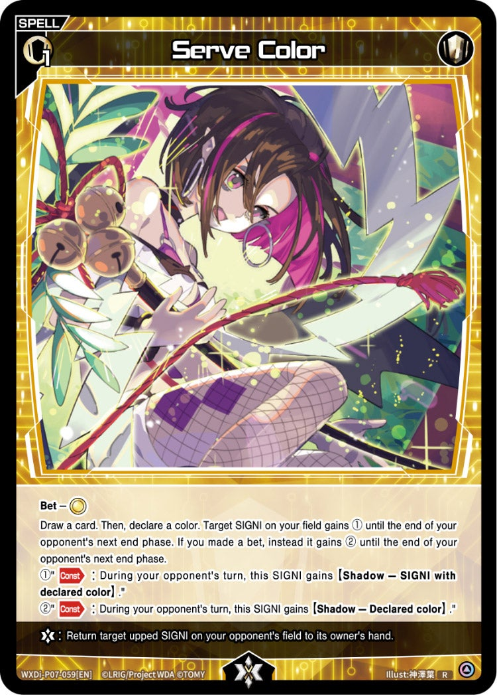

# Serve Color

## Thông tin lá

| Trường | Giá trị |
| --- | --- |
| Mã in | WXDi-P07-059[EN] |
| Set | WXDi-P07[EN] |
| Số thứ tự | 059 |
| Loại thẻ | SPELL |
| Vị trí | Main Deck |
| Số bản | — (set booster, không áp dụng) |
| Màu | Trắng |
| Độ hiếm | R,R(P) |
| Minh họa | 神澤葉 |
| Level | — |
| Limit | — |
| Power | 0 |
| LRIG type / Class | — |
| Team / Master | — |
| Cost | 《W》×１ |
| Grow cost | — |
| Use timing | — |
| Life Burst | Có |

## Card text chính thức

Bet — {Coin Icon}

Draw a card. Then, declare a color. Target SIGNI on your field gains ① until the end of your opponent's next end phase. If you made a bet, instead it gains ② until the end of your opponent's next end phase.
①"[Constant]: During your opponent's turn, this SIGNI gains 【Shadow — SIGNI with declared color】."
②"[Constant]: During your opponent's turn, this SIGNI gains 【Shadow — Declared color】."

## Power text / Life Burst

Return target upped SIGNI on your opponent's field to its owner's hand.

## Ghi chú minh họa
Artist: 神澤葉. Ảnh R được tải từ Card List tiếng Anh.

## FAQ chính thức

— (không có FAQ riêng cho mã này trên trang FAQ tiếng Anh.)

## Ảnh biến thể

- [R(P)](../images/WXDi-P07-059P-EN.jpg)

## Nguồn
[Card List/FAQ chính thức](https://www.takaratomy.co.jp/products/en.wixoss/card/card.html?card_no=WXDi-P07-059%5BEN%5D ) · [Ảnh thẻ](https://www.takaratomy.co.jp/products/en.wixoss/card/thumb/WXDi-P07-059%5BEN%5D.jpg)
