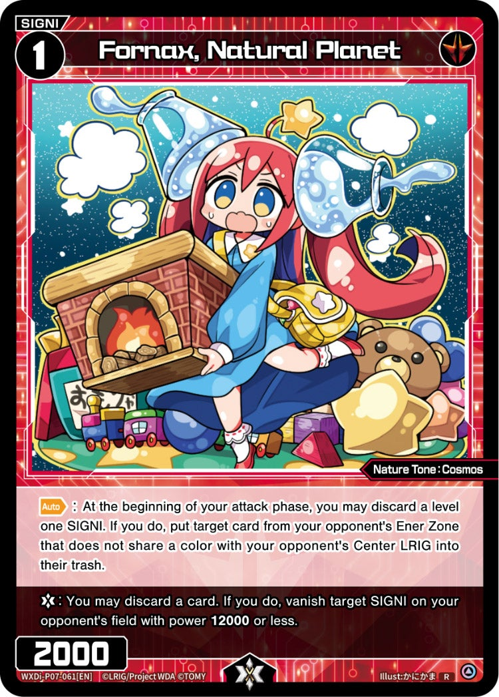

# Fornax, Natural Planet

## Thông tin lá

| Trường | Giá trị |
| --- | --- |
| Mã in | WXDi-P07-061[EN] |
| Set | WXDi-P07[EN] |
| Số thứ tự | 061 |
| Loại thẻ | SIGNI |
| Vị trí | Main Deck |
| Số bản | — (set booster, không áp dụng) |
| Màu | Đỏ |
| Độ hiếm | R,R(P) |
| Minh họa | かにかま |
| Level | 1 |
| Limit | — |
| Power | 2000 |
| LRIG type / Class | Nature Tone：Cosmos |
| Team / Master | — |
| Cost | — |
| Grow cost | — |
| Use timing | — |
| Life Burst | Có |

## Card text chính thức

[Auto]: At the beginning of your attack phase, you may discard a level one SIGNI. If you do, put target card from your opponent's Ener Zone that does not share a color with your opponent's Center LRIG into their trash.

## Power text / Life Burst

You may discard a card. If you do, vanish target SIGNI on your opponent's field with power 12000 or less.

## Ghi chú minh họa
Artist: かにかま. Ảnh R được tải từ Card List tiếng Anh.

## FAQ chính thức

**Q. May I discard SIGNI with any color from my hand by this SIGNI's [Auto] ability?**
A. Yes, as long as it is a level one SIGNI, there are no colour restrictions.

## Ảnh biến thể

- [R(P)](../images/WXDi-P07-061P-EN.jpg)

## Nguồn
[Card List/FAQ chính thức](https://www.takaratomy.co.jp/products/en.wixoss/card/card.html?card_no=WXDi-P07-061%5BEN%5D ) · [Ảnh thẻ](https://www.takaratomy.co.jp/products/en.wixoss/card/thumb/WXDi-P07-061%5BEN%5D.jpg)
