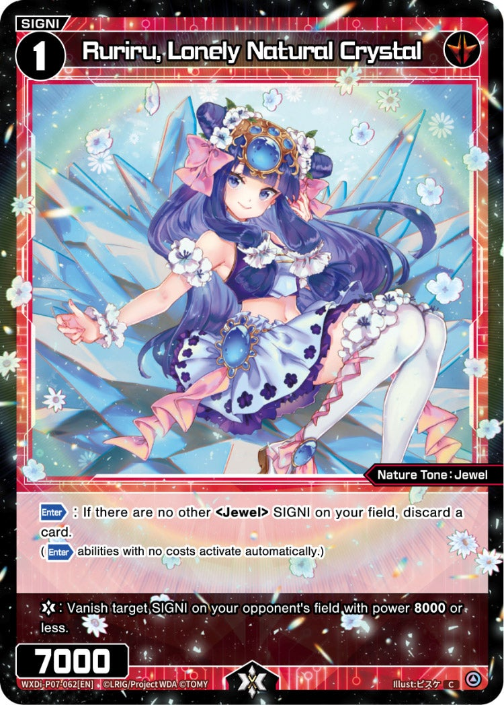

# Ruriru, Lonely Natural Crystal

## Thông tin lá

| Trường | Giá trị |
| --- | --- |
| Mã in | WXDi-P07-062[EN] |
| Set | WXDi-P07[EN] |
| Số thứ tự | 062 |
| Loại thẻ | SIGNI |
| Vị trí | Main Deck |
| Số bản | — (set booster, không áp dụng) |
| Màu | Đỏ |
| Độ hiếm | C,C(P) |
| Minh họa | ピスケ |
| Level | 1 |
| Limit | — |
| Power | 7000 |
| LRIG type / Class | Nature Tone：Jewel |
| Team / Master | — |
| Cost | — |
| Grow cost | — |
| Use timing | — |
| Life Burst | Có |

## Card text chính thức

[Enter]: If there are no other <Jewel> SIGNI on your field, discard a card.
([Enter] abilities with no costs activate automatically.)

## Power text / Life Burst

Vanish target SIGNI on your opponent's field with power 8000 or less.

## Ghi chú minh họa
Artist: ピスケ. Ảnh C được tải từ Card List tiếng Anh.

## FAQ chính thức

**Q. May I put this SIGNI on my field if I have no <Jewel> SIGNI in my field and only this SIGNI in my hand?**
A. Yes, you can. The effect of discarding a card from your hand is triggered, but since you have zero cards in your hand, nothing happens and this SIGNI remains on your field.

## Ảnh biến thể

- [C(P)](../images/WXDi-P07-062P-EN.jpg)

## Nguồn
[Card List/FAQ chính thức](https://www.takaratomy.co.jp/products/en.wixoss/card/card.html?card_no=WXDi-P07-062%5BEN%5D ) · [Ảnh thẻ](https://www.takaratomy.co.jp/products/en.wixoss/card/thumb/WXDi-P07-062%5BEN%5D.jpg)
