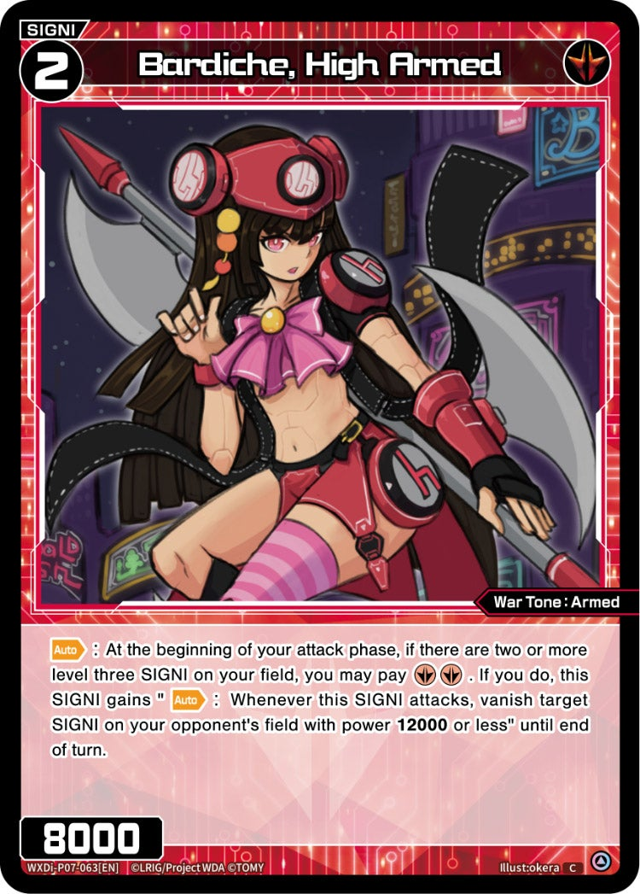

# Bardiche, High Armed

## Thông tin lá

| Trường | Giá trị |
| --- | --- |
| Mã in | WXDi-P07-063[EN] |
| Set | WXDi-P07[EN] |
| Số thứ tự | 063 |
| Loại thẻ | SIGNI |
| Vị trí | Main Deck |
| Số bản | — (set booster, không áp dụng) |
| Màu | Đỏ |
| Độ hiếm | C,C(P) |
| Minh họa | okera |
| Level | 2 |
| Limit | — |
| Power | 8000 |
| LRIG type / Class | War Tone：Armed |
| Team / Master | — |
| Cost | — |
| Grow cost | — |
| Use timing | — |
| Life Burst | Không |

## Card text chính thức

[Auto]: At the beginning of your attack phase, if there are two or more level three SIGNI on your field, you may pay {Red} {Red}. If you do, this SIGNI gains "[Auto]: Whenever this SIGNI attacks, vanish target SIGNI on your opponent's field with power 12000 or less" until end of turn.

## Power text / Life Burst

—

## Ghi chú minh họa
Artist: okera. Ảnh C được tải từ Card List tiếng Anh.

## FAQ chính thức

**Q. At the beginning of this SIGNI's Attack Phase, the [Auto] ability was triggered and the condition was met, so I paid {Red} {Red} and this SIGNI gained an ability. If the number of Level three SIGNI in my field is reduced afterwards, what happens to the ability this SIGNI had gained?**
A. Until the end of the turn, the ability that this SIGNI had gained remains gained. This card only check if the conditions are met when the [Auto] ability is triggered at the beginning of the Attack Phase.

**Q. At the beginning of this SIGNI's Attack Phase, the [Auto] ability was triggered and the condition was met, so I paid {Red} {Red} and this SIGNI gained an ability. May my opponent use cards and abilities available in the Attack Phase?**
A. Yes, your opponent can. The Attack Phase first triggers the ability that triggers at the start of the Attack Phase, and then your opponent can use the cards available for the Attack Phase in the Pre-attack Step and Defence Step respectively.

## Ảnh biến thể

- [C(P)](../images/WXDi-P07-063P-EN.jpg)

## Nguồn
[Card List/FAQ chính thức](https://www.takaratomy.co.jp/products/en.wixoss/card/card.html?card_no=WXDi-P07-063%5BEN%5D ) · [Ảnh thẻ](https://www.takaratomy.co.jp/products/en.wixoss/card/thumb/WXDi-P07-063%5BEN%5D.jpg)
