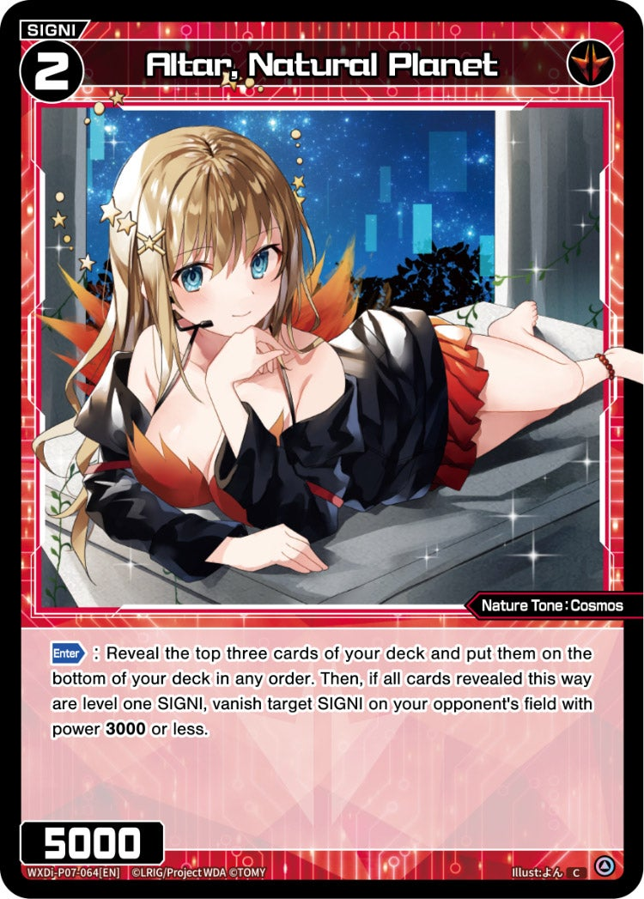

# Altar, Natural Planet

## Thông tin lá

| Trường | Giá trị |
| --- | --- |
| Mã in | WXDi-P07-064[EN] |
| Set | WXDi-P07[EN] |
| Số thứ tự | 064 |
| Loại thẻ | SIGNI |
| Vị trí | Main Deck |
| Số bản | — (set booster, không áp dụng) |
| Màu | Đỏ |
| Độ hiếm | C,C(P) |
| Minh họa | よん |
| Level | 2 |
| Limit | — |
| Power | 5000 |
| LRIG type / Class | Nature Tone：Cosmos |
| Team / Master | — |
| Cost | — |
| Grow cost | — |
| Use timing | — |
| Life Burst | Không |

## Card text chính thức

[Enter]: Reveal the top three cards of your deck and put them on the bottom of your deck in any order. Then, if all cards revealed this way are level one SIGNI, vanish target SIGNI on your opponent's field with power 3000 or less.

## Power text / Life Burst

—

## Ghi chú minh họa
Artist: よん. Ảnh C được tải từ Card List tiếng Anh.

## FAQ chính thức

**Q. If the revealed cards are two level one SIGNI and a spell, may I vanish my opponent's SIGNI?**
A. No, you cannot. Not all revealed SIGNI must be level one, all revealed CARDs must be level one SIGNI.

**Q. What happens if there are two or less cards in my deck when this card triggered this [Enter] ability?**
A. If you do, reveal all cards in your deck of two or less. If they are all level one SIGNI, you can vanish target your opponent's SIGNI with power 3000 or less.

## Ảnh biến thể

- [C(P)](../images/WXDi-P07-064P-EN.jpg)

## Nguồn
[Card List/FAQ chính thức](https://www.takaratomy.co.jp/products/en.wixoss/card/card.html?card_no=WXDi-P07-064%5BEN%5D ) · [Ảnh thẻ](https://www.takaratomy.co.jp/products/en.wixoss/card/thumb/WXDi-P07-064%5BEN%5D.jpg)
