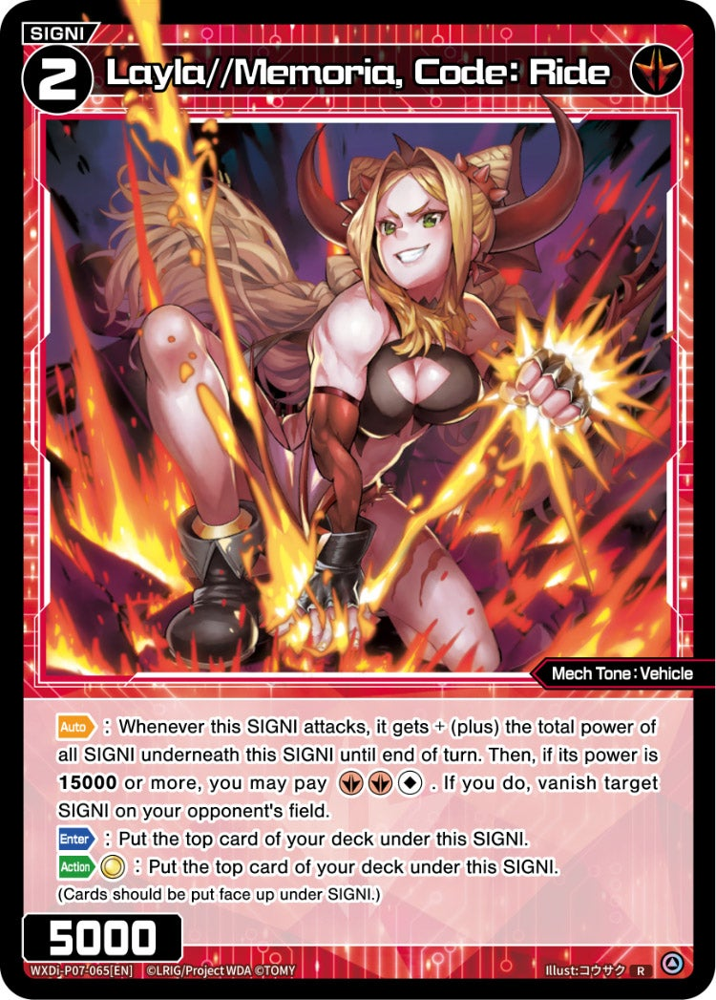

# Layla//Memoria, Code: Ride

## Thông tin lá

| Trường | Giá trị |
| --- | --- |
| Mã in | WXDi-P07-065[EN] |
| Set | WXDi-P07[EN] |
| Số thứ tự | 065 |
| Loại thẻ | SIGNI |
| Vị trí | Main Deck |
| Số bản | — (set booster, không áp dụng) |
| Màu | Đỏ |
| Độ hiếm | R,R(P) |
| Minh họa | コウサク |
| Level | 2 |
| Limit | — |
| Power | 5000 |
| LRIG type / Class | Mech Tone：Vehicle |
| Team / Master | — |
| Cost | — |
| Grow cost | — |
| Use timing | — |
| Life Burst | Không |

## Card text chính thức

[Auto]: Whenever this SIGNI attacks, it gets + (plus) the total power of all SIGNI underneath this SIGNI until end of turn. Then, if its power is 15000 or more, you may pay {Red} {Red} {Colorless}. If you do, vanish target SIGNI on your opponent's field.
[Enter]: Put the top card of your deck under this SIGNI.
[Action] {Coin Icon}: Put the top card of your deck under this SIGNI.
(Cards should be put face up under SIGNI.)

## Power text / Life Burst

—

## Ghi chú minh họa
Artist: コウサク. Ảnh R được tải từ Card List tiếng Anh.

## FAQ chính thức

**Q. If this SIGNI has power added by the [Auto] ability when it attacks, does it battle the SIGNI in front of it after its power is increased?**
A. Yes, it battle the SIGNI in front of it after processing the [Auto] ability when it attack. If this ability vanishes the SIGNI in front of it and there are no more front SIGNI, it deal damage to your opponent.

**Q. My opponent put 《Machina Bind》 and this SIGNI got "[Auto]: Whenever this SIGNI attacks, this SIGNI gets -20000 power until end of turn" by the effect of 《Machina Bind》. What happens if this SIGNI attacks?**
A. When this SIGNI attacks, both this SIGNI's own [Auto] ability and the [Auto] ability given by 《Machina Bind》 are triggered and can be processed in any order. If this SIGNI's [Auto] ability resolves first and this SIGNI's power is more than 20000, you can pay Ener cost to vanish your opponent's SIGNI and it will remain on the field even if this SIGNI is subsequently reduced to -20000 power.

## Ảnh biến thể

- [R(P)](../images/WXDi-P07-065P-EN.jpg)

## Nguồn
[Card List/FAQ chính thức](https://www.takaratomy.co.jp/products/en.wixoss/card/card.html?card_no=WXDi-P07-065%5BEN%5D ) · [Ảnh thẻ](https://www.takaratomy.co.jp/products/en.wixoss/card/thumb/WXDi-P07-065%5BEN%5D.jpg)
