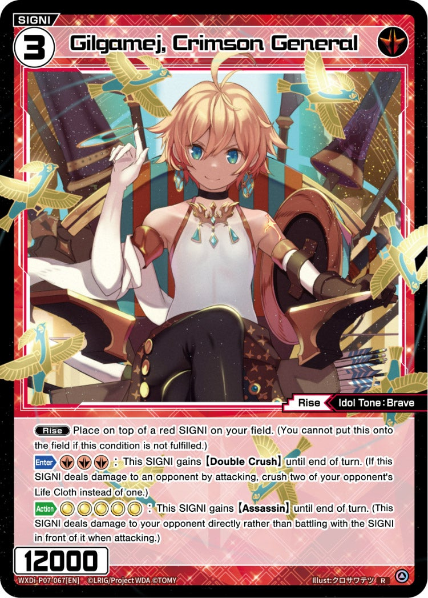

# Gilgamej, Crimson General

## Thông tin lá

| Trường | Giá trị |
| --- | --- |
| Mã in | WXDi-P07-067[EN] |
| Set | WXDi-P07[EN] |
| Số thứ tự | 067 |
| Loại thẻ | SIGNI |
| Vị trí | Main Deck |
| Số bản | — (set booster, không áp dụng) |
| Màu | Đỏ |
| Độ hiếm | R,R(P) |
| Minh họa | クロサワテツ |
| Level | 3 |
| Limit | — |
| Power | 12000 |
| LRIG type / Class | Idol Tone：Brave |
| Team / Master | — |
| Cost | — |
| Grow cost | — |
| Use timing | — |
| Life Burst | Không |

## Card text chính thức

[Rise] Place on top of a red SIGNI on your field. (You cannot put this onto the field if this condition is not fulfilled.)
[Enter] {Red} {Red} {Red}: This SIGNI gains 【Double Crush】 until end of turn. (If this SIGNI deals damage to an opponent by attacking, crush two of your opponent's Life Cloth instead of one.)
[Action] {Coin Icon} {Coin Icon} {Coin Icon} {Coin Icon} {Coin Icon}: This SIGNI gains 【Assassin】 until end of turn. (This SIGNI deals damage to your opponent directly rather than battling with the SIGNI in front of it when attacking.)

## Power text / Life Burst

—

## Ghi chú minh họa
Artist: クロサワテツ. Ảnh R được tải từ Card List tiếng Anh.

## FAQ chính thức

— (không có FAQ riêng cho mã này trên trang FAQ tiếng Anh.)

## Ảnh biến thể

- [R(P)](../images/WXDi-P07-067P-EN.jpg)

## Nguồn
[Card List/FAQ chính thức](https://www.takaratomy.co.jp/products/en.wixoss/card/card.html?card_no=WXDi-P07-067%5BEN%5D ) · [Ảnh thẻ](https://www.takaratomy.co.jp/products/en.wixoss/card/thumb/WXDi-P07-067%5BEN%5D.jpg)
