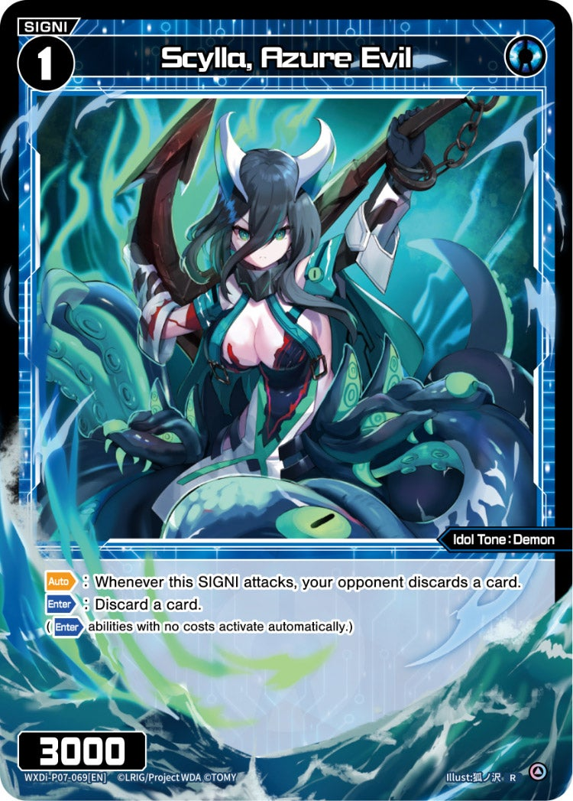

# Scylla, Azure Evil

## Thông tin lá

| Trường | Giá trị |
| --- | --- |
| Mã in | WXDi-P07-069[EN] |
| Set | WXDi-P07[EN] |
| Số thứ tự | 069 |
| Loại thẻ | SIGNI |
| Vị trí | Main Deck |
| Số bản | — (set booster, không áp dụng) |
| Màu | Xanh dương |
| Độ hiếm | R,R(P) |
| Minh họa | 狐ノ沢 |
| Level | 1 |
| Limit | — |
| Power | 3000 |
| LRIG type / Class | Idol Tone：Demon |
| Team / Master | — |
| Cost | — |
| Grow cost | — |
| Use timing | — |
| Life Burst | Không |

## Card text chính thức

[Auto]: Whenever this SIGNI attacks, your opponent discards a card.
[Enter]: Discard a card.
([Enter] abilities with no costs activate automatically.)

## Power text / Life Burst

—

## Ghi chú minh họa
Artist: 狐ノ沢. Ảnh R được tải từ Card List tiếng Anh.

## FAQ chính thức

**Q. May I put this SIGNI on my field if I have only this SIGNI in my hand?**
A. Yes, you can. The effect of discarding a card from your hand is triggered, but since you have zero cards in your hand, nothing happens and this SIGNI remains on your field.

## Ảnh biến thể

- [R(P)](../images/WXDi-P07-069P-EN.jpg)

## Nguồn
[Card List/FAQ chính thức](https://www.takaratomy.co.jp/products/en.wixoss/card/card.html?card_no=WXDi-P07-069%5BEN%5D ) · [Ảnh thẻ](https://www.takaratomy.co.jp/products/en.wixoss/card/thumb/WXDi-P07-069%5BEN%5D.jpg)
