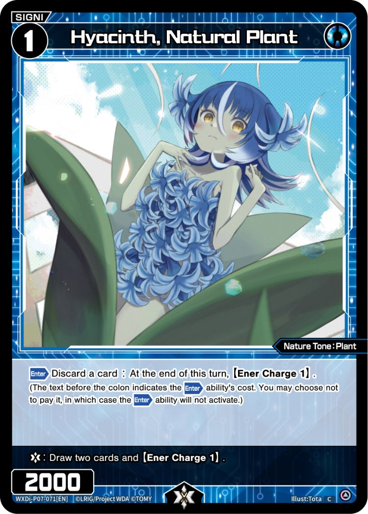

# Hyacinth, Natural Plant

## Thông tin lá

| Trường | Giá trị |
| --- | --- |
| Mã in | WXDi-P07-071[EN] |
| Set | WXDi-P07[EN] |
| Số thứ tự | 071 |
| Loại thẻ | SIGNI |
| Vị trí | Main Deck |
| Số bản | — (set booster, không áp dụng) |
| Màu | Xanh dương |
| Độ hiếm | C,C(P) |
| Minh họa | Tota |
| Level | 1 |
| Limit | — |
| Power | 2000 |
| LRIG type / Class | Nature Tone：Plant |
| Team / Master | — |
| Cost | — |
| Grow cost | — |
| Use timing | — |
| Life Burst | Có |

## Card text chính thức

[Enter] Discard a card: At the end of this turn, 【Ener Charge 1】.
(The text before the colon indicates the [Enter] ability's cost. You may choose not to pay it, in which case the [Enter] ability will not activate.)

## Power text / Life Burst

Draw two cards and 【Ener Charge 1】.

## Ghi chú minh họa
Artist: Tota. Ảnh C được tải từ Card List tiếng Anh.

## FAQ chính thức

**Q. After resolving this [Enter] ability, this SIGNI left the field during the turn. May I 【Ener Charge 1】 at the end of the turn?**
A. Yes, you can. After resolving this [Enter] ability, you can 【Ener Charge 1】 at the end of the turn, regardless of what happened to this SIGNI.

## Ảnh biến thể

- [C(P)](../images/WXDi-P07-071P-EN.jpg)

## Nguồn
[Card List/FAQ chính thức](https://www.takaratomy.co.jp/products/en.wixoss/card/card.html?card_no=WXDi-P07-071%5BEN%5D ) · [Ảnh thẻ](https://www.takaratomy.co.jp/products/en.wixoss/card/thumb/WXDi-P07-071%5BEN%5D.jpg)
