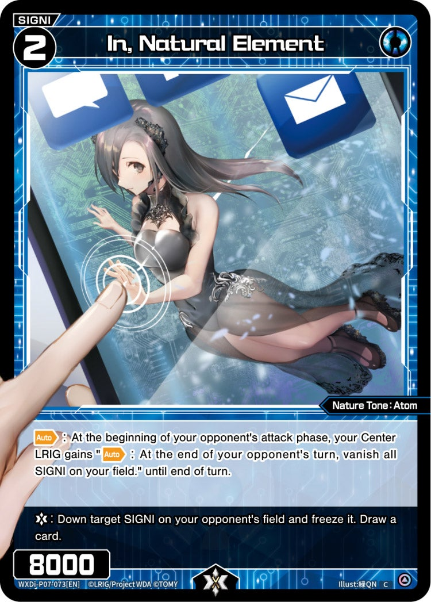

# In, Natural Element

## Thông tin lá

| Trường | Giá trị |
| --- | --- |
| Mã in | WXDi-P07-073[EN] |
| Set | WXDi-P07[EN] |
| Số thứ tự | 073 |
| Loại thẻ | SIGNI |
| Vị trí | Main Deck |
| Số bản | — (set booster, không áp dụng) |
| Màu | Xanh dương |
| Độ hiếm | C,C(P) |
| Minh họa | 緑QN |
| Level | 2 |
| Limit | — |
| Power | 8000 |
| LRIG type / Class | Nature Tone：Atom |
| Team / Master | — |
| Cost | — |
| Grow cost | — |
| Use timing | — |
| Life Burst | Có |

## Card text chính thức

[Auto]: At the beginning of your opponent's attack phase, your Center LRIG gains "[Auto]: At the end of your opponent's turn, vanish all SIGNI on your field." until end of turn.

## Power text / Life Burst

Down target SIGNI on your opponent's field and freeze it. Draw a card.

## Ghi chú minh họa
Artist: 緑QN. Ảnh C được tải từ Card List tiếng Anh.

## FAQ chính thức

**Q. At the beginning of my opponent's Attack Phase, center LRIG gained an ability by this SIGNI's [Auto] ability. If this SIGNI is subsequently vanished in battle, what happens to the ability center LRIG gained?**
A. Even if this SIGNI leaves the field, the ability gained by the centre LRIG remain gained until end of turn. At end of turn, the [Auto] ability gained is triggered as normal.

## Ảnh biến thể

- [C(P)](../images/WXDi-P07-073P-EN.jpg)

## Nguồn
[Card List/FAQ chính thức](https://www.takaratomy.co.jp/products/en.wixoss/card/card.html?card_no=WXDi-P07-073%5BEN%5D ) · [Ảnh thẻ](https://www.takaratomy.co.jp/products/en.wixoss/card/thumb/WXDi-P07-073%5BEN%5D.jpg)
