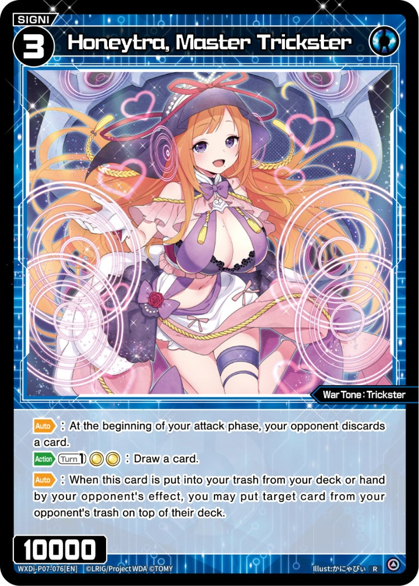

# Honeytra, Master Trickster

## Thông tin lá

| Trường | Giá trị |
| --- | --- |
| Mã in | WXDi-P07-076[EN] |
| Set | WXDi-P07[EN] |
| Số thứ tự | 076 |
| Loại thẻ | SIGNI |
| Vị trí | Main Deck |
| Số bản | — (set booster, không áp dụng) |
| Màu | Xanh dương |
| Độ hiếm | R,R(P) |
| Minh họa | かにゃぴぃ |
| Level | 3 |
| Limit | — |
| Power | 10000 |
| LRIG type / Class | War Tone：Trickster |
| Team / Master | — |
| Cost | — |
| Grow cost | — |
| Use timing | — |
| Life Burst | Không |

## Card text chính thức

[Auto]: At the beginning of your attack phase, your opponent discards a card.
[Action] {1/Turn} {Coin Icon} {Coin Icon}: Draw a card.

[Auto]: When this card is put into your trash from your deck or hand by your opponent's effect, you may put target card from your opponent's trash on the bottom of their deck.

## Power text / Life Burst

—

## Ghi chú minh họa
Artist: かにゃぴぃ. Ảnh R được tải từ Card List tiếng Anh.

## FAQ chính thức

**Q. If the second [Auto] ability put a card from my opponent's trash on top of its owner's deck, which player's deck?**
A. It is put on top of your opponent's deck. Basically, your opponent's cards are never put on top of your deck.

## Ảnh biến thể

- [R(P)](../images/WXDi-P07-076P-EN.jpg)

## Nguồn
[Card List/FAQ chính thức](https://www.takaratomy.co.jp/products/en.wixoss/card/card.html?card_no=WXDi-P07-076%5BEN%5D ) · [Ảnh thẻ](https://www.takaratomy.co.jp/products/en.wixoss/card/thumb/WXDi-P07-076%5BEN%5D.jpg)
