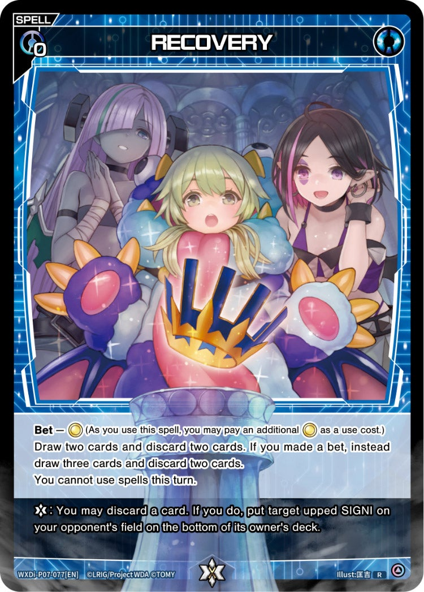

# RECOVERY

## Thông tin lá

| Trường | Giá trị |
| --- | --- |
| Mã in | WXDi-P07-077[EN] |
| Set | WXDi-P07[EN] |
| Số thứ tự | 077 |
| Loại thẻ | SPELL |
| Vị trí | Main Deck |
| Số bản | — (set booster, không áp dụng) |
| Màu | Xanh dương |
| Độ hiếm | R,R(P) |
| Minh họa | 匡吉 |
| Level | — |
| Limit | — |
| Power | 0 |
| LRIG type / Class | — |
| Team / Master | — |
| Cost | 《U》×０ |
| Grow cost | — |
| Use timing | — |
| Life Burst | Có |

## Card text chính thức

Bet — {Coin Icon} (As you use this spell, you may pay an additional {Coin Icon} as a use cost.)

Draw two cards and discard two cards. If you made a bet, instead draw three cards and discard two cards.
You cannot use spells this turn.

## Power text / Life Burst

You may discard a card. If you do, put target upped SIGNI on your opponent's field on the bottom of its owner's deck.

## Ghi chú minh họa
Artist: 匡吉. Ảnh R được tải từ Card List tiếng Anh.

## FAQ chính thức

**Q. May I trigger the spell's Life Burst after using this spell?**
A. Yes, you can. Even if you cannot use a spell, you can trigger the Life Burst of a spell, as it is not a use.

## Ảnh biến thể

- [R(P)](../images/WXDi-P07-077P-EN.jpg)

## Nguồn
[Card List/FAQ chính thức](https://www.takaratomy.co.jp/products/en.wixoss/card/card.html?card_no=WXDi-P07-077%5BEN%5D ) · [Ảnh thẻ](https://www.takaratomy.co.jp/products/en.wixoss/card/thumb/WXDi-P07-077%5BEN%5D.jpg)
