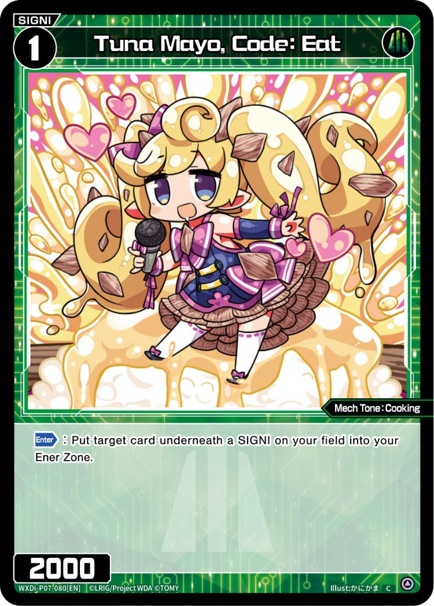

# Tuna Mayo, Code: Eat

## Thông tin lá

| Trường | Giá trị |
| --- | --- |
| Mã in | WXDi-P07-080[EN] |
| Set | WXDi-P07[EN] |
| Số thứ tự | 080 |
| Loại thẻ | SIGNI |
| Vị trí | Main Deck |
| Số bản | — (set booster, không áp dụng) |
| Màu | Xanh lá |
| Độ hiếm | C,C(P) |
| Minh họa | かにかま |
| Level | 1 |
| Limit | — |
| Power | 2000 |
| LRIG type / Class | Mech Tone：Cooking |
| Team / Master | — |
| Cost | — |
| Grow cost | — |
| Use timing | — |
| Life Burst | Không |

## Card text chính thức

[Enter]: Put target card underneath a SIGNI on your field into your Ener Zone.

## Power text / Life Burst

—

## Ghi chú minh họa
Artist: かにかま. Ảnh C được tải từ Card List tiếng Anh.

## FAQ chính thức

**Q. If a card is turnd face down in the SIGNI Zone, for example by the effect of 《Robin Hood, Jade General Queen》, and put SIGNI on its zone, does the card placed face down become the underneath this SIGNI?**
A. Cards turned face down by the effect of 《Robin Hood, Jade General Queen》 or 【Hastalyk】, 【Virus】are not treated as cards placed under a SIGNI, even if they are physically unederneath to a SIGNI.

## Ảnh biến thể

- [C(P)](../images/WXDi-P07-080P-EN.jpg)

## Nguồn
[Card List/FAQ chính thức](https://www.takaratomy.co.jp/products/en.wixoss/card/card.html?card_no=WXDi-P07-080%5BEN%5D ) · [Ảnh thẻ](https://www.takaratomy.co.jp/products/en.wixoss/card/thumb/WXDi-P07-080%5BEN%5D.jpg)
