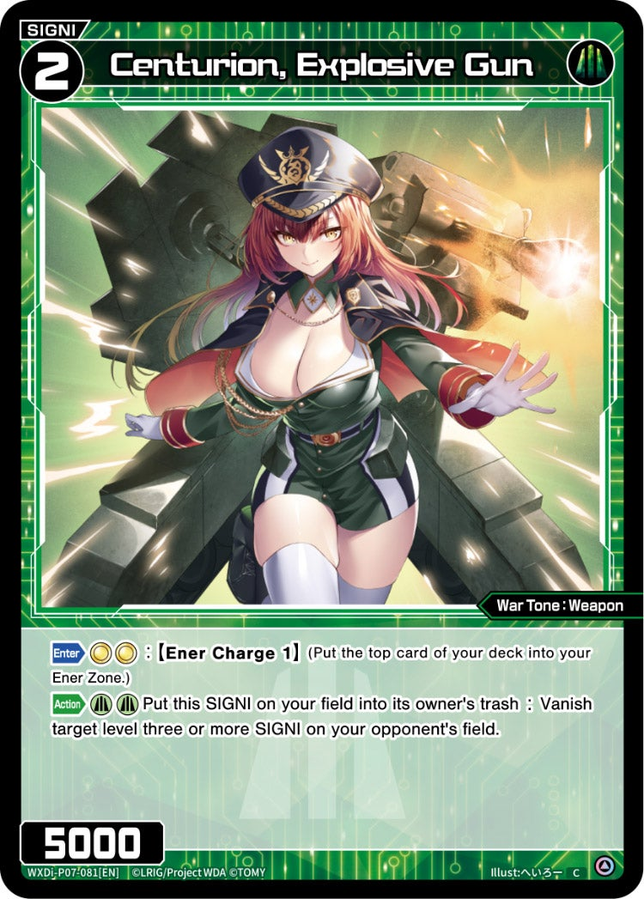

# Centurion, Explosive Gun

## Thông tin lá

| Trường | Giá trị |
| --- | --- |
| Mã in | WXDi-P07-081[EN] |
| Set | WXDi-P07[EN] |
| Số thứ tự | 081 |
| Loại thẻ | SIGNI |
| Vị trí | Main Deck |
| Số bản | — (set booster, không áp dụng) |
| Màu | Xanh lá |
| Độ hiếm | C,C(P) |
| Minh họa | へいろー |
| Level | 2 |
| Limit | — |
| Power | 5000 |
| LRIG type / Class | War Tone：Weapon |
| Team / Master | — |
| Cost | — |
| Grow cost | — |
| Use timing | — |
| Life Burst | Không |

## Card text chính thức

[Enter] {Coin Icon} {Coin Icon}: 【Ener Charge 1】 (Put the top card of your deck into your Ener Zone.)
[Action] {Green} {Green} Put this SIGNI on your field into its owner's trash: Vanish target level three or more SIGNI on your opponent's field.

## Power text / Life Burst

—

## Ghi chú minh họa
Artist: へいろー. Ảnh C được tải từ Card List tiếng Anh.

## FAQ chính thức

— (không có FAQ riêng cho mã này trên trang FAQ tiếng Anh.)

## Ảnh biến thể

- [C(P)](../images/WXDi-P07-081P-EN.jpg)

## Nguồn
[Card List/FAQ chính thức](https://www.takaratomy.co.jp/products/en.wixoss/card/card.html?card_no=WXDi-P07-081%5BEN%5D ) · [Ảnh thẻ](https://www.takaratomy.co.jp/products/en.wixoss/card/thumb/WXDi-P07-081%5BEN%5D.jpg)
