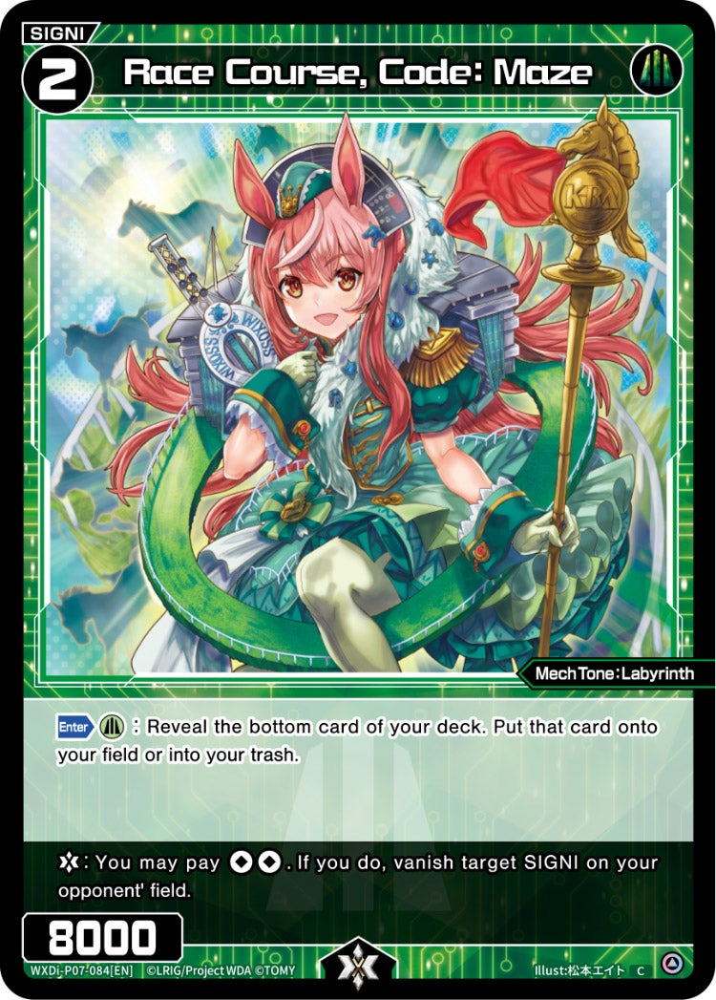

# Race Course, Code: Maze

## Thông tin lá

| Trường | Giá trị |
| --- | --- |
| Mã in | WXDi-P07-084[EN] |
| Set | WXDi-P07[EN] |
| Số thứ tự | 084 |
| Loại thẻ | SIGNI |
| Vị trí | Main Deck |
| Số bản | — (set booster, không áp dụng) |
| Màu | Xanh lá |
| Độ hiếm | C,C(P) |
| Minh họa | 松本エイト |
| Level | 2 |
| Limit | — |
| Power | 8000 |
| LRIG type / Class | Mech Tone：Labyrinth |
| Team / Master | — |
| Cost | — |
| Grow cost | — |
| Use timing | — |
| Life Burst | Có |

## Card text chính thức

[Enter] {Green}: Reveal the bottom card of your deck. Put that card onto your field or into your trash.

## Power text / Life Burst

You may pay {Colorless} {Colorless}. If you do, vanish target SIGNI on your opponent's field.

## Ghi chú minh họa
Artist: 松本エイト. Ảnh C được tải từ Card List tiếng Anh.

## FAQ chính thức

**Q. If I reveal a card at the bottom of my deck, but it has exceeded its level or total limit, or all SIGNI zones are full, may I choose to put it on my field? If not, what happens to revealed card?**
A. You cannot put it on your field. If you cannot put a SIGNI on your field, you cannot choose to put it, so the card is put into your trash. Similarly, if a spell is revealed, you cannot choose to put it, so it is put into your trash.

## Ảnh biến thể

- [C(P)](../images/WXDi-P07-084P-EN.jpg)

## Nguồn
[Card List/FAQ chính thức](https://www.takaratomy.co.jp/products/en.wixoss/card/card.html?card_no=WXDi-P07-084%5BEN%5D ) · [Ảnh thẻ](https://www.takaratomy.co.jp/products/en.wixoss/card/thumb/WXDi-P07-084%5BEN%5D.jpg)
