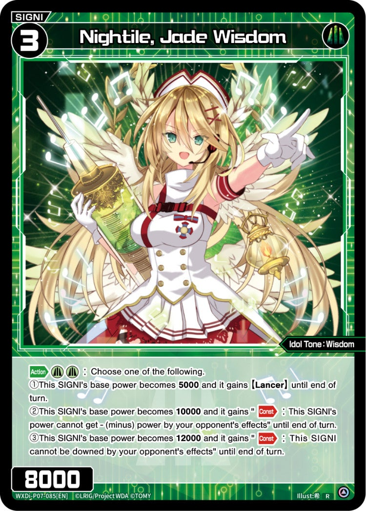

# Nightile, Jade Wisdom

## Thông tin lá

| Trường | Giá trị |
| --- | --- |
| Mã in | WXDi-P07-085[EN] |
| Set | WXDi-P07[EN] |
| Số thứ tự | 085 |
| Loại thẻ | SIGNI |
| Vị trí | Main Deck |
| Số bản | — (set booster, không áp dụng) |
| Màu | Xanh lá |
| Độ hiếm | R,R(P) |
| Minh họa | 希 |
| Level | 3 |
| Limit | — |
| Power | 8000 |
| LRIG type / Class | Idol Tone：Wisdom |
| Team / Master | — |
| Cost | — |
| Grow cost | — |
| Use timing | — |
| Life Burst | Không |

## Card text chính thức

[Action] {Green} {Green}: Choose one of the following.
①This SIGNI's base power becomes 5000 and it gains 【Lancer】 until end of turn.
②This SIGNI's base power becomes 10000 and it gains "[Constant]: This SIGNI's power cannot get - (minus) power by your opponent's effects" until end of turn.
③This SIGNI's base power becomes 12000 and it gains "[Constant]: This SIGNI cannot be downed by your opponent's effects" until end of turn.

## Power text / Life Burst

—

## Ghi chú minh họa
Artist: 希. Ảnh R được tải từ Card List tiếng Anh.

## FAQ chính thức

**Q. What happens if this [Action] ability is used more than once?**
A. The power becomes the power of the last number you chose and this SIGNI gain all the abilities you chose. For example, if you choose ① and then ②, this SIGNI base power becomes 10000 and it gains 【Lancer】 and the [Constant] ability of ②.

## Ảnh biến thể

- [R(P)](../images/WXDi-P07-085P-EN.jpg)

## Nguồn
[Card List/FAQ chính thức](https://www.takaratomy.co.jp/products/en.wixoss/card/card.html?card_no=WXDi-P07-085%5BEN%5D ) · [Ảnh thẻ](https://www.takaratomy.co.jp/products/en.wixoss/card/thumb/WXDi-P07-085%5BEN%5D.jpg)
