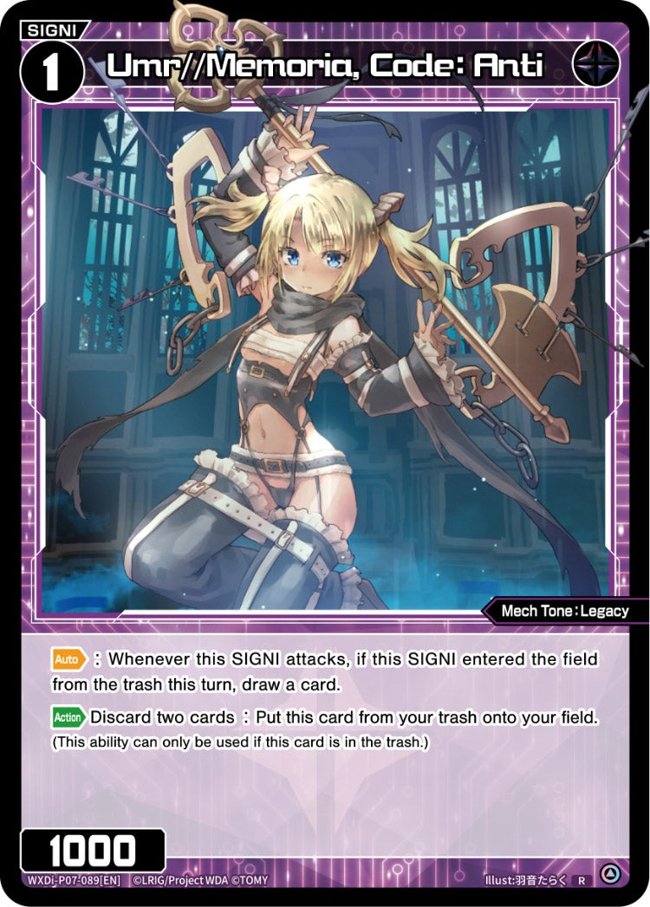

# Umr//Memoria, Code: Anti

## Thông tin lá

| Trường | Giá trị |
| --- | --- |
| Mã in | WXDi-P07-089[EN] |
| Set | WXDi-P07[EN] |
| Số thứ tự | 089 |
| Loại thẻ | SIGNI |
| Vị trí | Main Deck |
| Số bản | — (set booster, không áp dụng) |
| Màu | Đen |
| Độ hiếm | R,R(P) |
| Minh họa | 羽音たらく |
| Level | 1 |
| Limit | — |
| Power | 1000 |
| LRIG type / Class | Mech Tone：Legacy |
| Team / Master | — |
| Cost | — |
| Grow cost | — |
| Use timing | — |
| Life Burst | Không |

## Card text chính thức

[Auto]: Whenever this SIGNI attacks, if this SIGNI entered the field from the trash this turn, draw a card.

[Action] Discard two cards: Put this card from your trash onto your field. (This ability can only be used if this card is in the trash.)

## Power text / Life Burst

—

## Ghi chú minh họa
Artist: 羽音たらく. Ảnh R được tải từ Card List tiếng Anh.

## FAQ chính thức

**Q. By discarding this SIGNI from may hand at the cost of this [Action] ability, may I put it on the field with its effect as it is?**
A. No. If this SIGNI itself is not in your trash, it cannot declare the use of its [Action] Ability and discard a card from your hand in the first place.

## Ảnh biến thể

- [R(P)](../images/WXDi-P07-089P-EN.jpg)

## Nguồn
[Card List/FAQ chính thức](https://www.takaratomy.co.jp/products/en.wixoss/card/card.html?card_no=WXDi-P07-089%5BEN%5D ) · [Ảnh thẻ](https://www.takaratomy.co.jp/products/en.wixoss/card/thumb/WXDi-P07-089%5BEN%5D.jpg)
