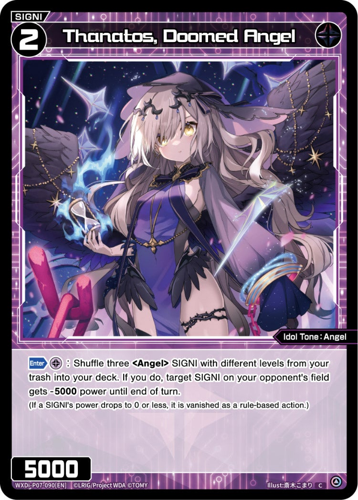

# Thanatos, Doomed Angel

## Thông tin lá

| Trường | Giá trị |
| --- | --- |
| Mã in | WXDi-P07-090[EN] |
| Set | WXDi-P07[EN] |
| Số thứ tự | 090 |
| Loại thẻ | SIGNI |
| Vị trí | Main Deck |
| Số bản | — (set booster, không áp dụng) |
| Màu | Đen |
| Độ hiếm | C,C(P) |
| Minh họa | 斎木こまり |
| Level | 2 |
| Limit | — |
| Power | 5000 |
| LRIG type / Class | Idol Tone：Angel |
| Team / Master | — |
| Cost | — |
| Grow cost | — |
| Use timing | — |
| Life Burst | Không |

## Card text chính thức

[Enter] {Black}: Shuffle three <Angel> SIGNI with different levels from your trash into your deck. If you do, target SIGNI on your opponent's field gets -5000 power until end of turn.
(If a SIGNI's power drops to 0 or less, it is vanished as a rule-based action.)

## Power text / Life Burst

—

## Ghi chú minh họa
Artist: 斎木こまり. Ảnh C được tải từ Card List tiếng Anh.

## FAQ chính thức

**Q. May I add two <Angel> SIGNI of different levels by this [Enter] ability to my deck even if there are only have two <Angel> SIGNI in my trash?**
A. No, you cannot. If you do not have three cards that meet the conditions, you cannot add any of them to your deck.

## Ảnh biến thể

- [C(P)](../images/WXDi-P07-090P-EN.jpg)

## Nguồn
[Card List/FAQ chính thức](https://www.takaratomy.co.jp/products/en.wixoss/card/card.html?card_no=WXDi-P07-090%5BEN%5D ) · [Ảnh thẻ](https://www.takaratomy.co.jp/products/en.wixoss/card/thumb/WXDi-P07-090%5BEN%5D.jpg)
