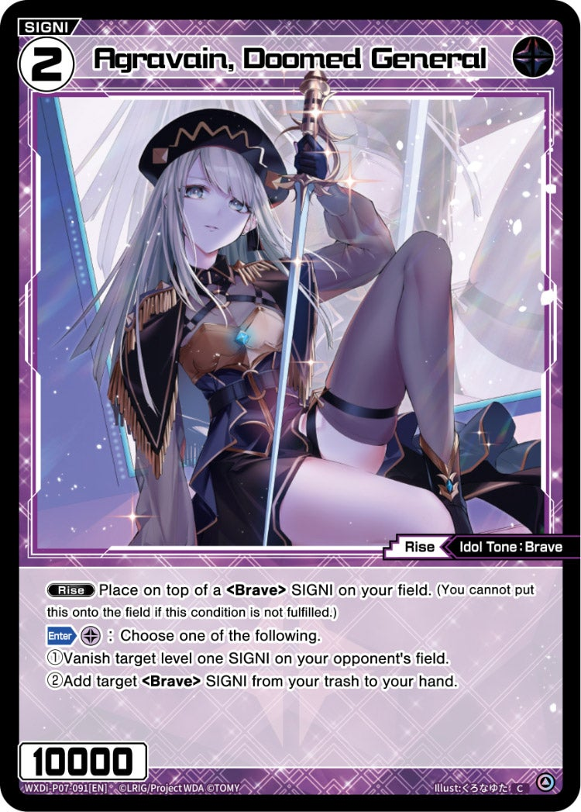

# Agravain, Doomed General

## Thông tin lá

| Trường | Giá trị |
| --- | --- |
| Mã in | WXDi-P07-091[EN] |
| Set | WXDi-P07[EN] |
| Số thứ tự | 091 |
| Loại thẻ | SIGNI |
| Vị trí | Main Deck |
| Số bản | — (set booster, không áp dụng) |
| Màu | Đen |
| Độ hiếm | C,C(P) |
| Minh họa | くろなゆた |
| Level | 2 |
| Limit | — |
| Power | 10000 |
| LRIG type / Class | Idol Tone：Brave |
| Team / Master | — |
| Cost | — |
| Grow cost | — |
| Use timing | — |
| Life Burst | Không |

## Card text chính thức

[Rise] Place on top of a <Brave> SIGNI on your field. (You cannot put this onto the field if this condition is not fulfilled.)
[Enter] {Black}: Choose one of the following.
①Vanish target level one SIGNI on your opponent's field.
②Add target <Brave> SIGNI from your trash to your hand.

## Power text / Life Burst

—

## Ghi chú minh họa
Artist: くろなゆた. Ảnh C được tải từ Card List tiếng Anh.

## FAQ chính thức

**Q. May the card that paid the cost of this [Enter] ability and was put into my trash be added to my hand by the effect of ②?**
A. Yes, you pay the cost and then choose either ① or ②, and then choose the target, which can be any card that meets the conditions in your trash at that time.

## Ảnh biến thể

- [C(P)](../images/WXDi-P07-091P-EN.jpg)

## Nguồn
[Card List/FAQ chính thức](https://www.takaratomy.co.jp/products/en.wixoss/card/card.html?card_no=WXDi-P07-091%5BEN%5D ) · [Ảnh thẻ](https://www.takaratomy.co.jp/products/en.wixoss/card/thumb/WXDi-P07-091%5BEN%5D.jpg)
