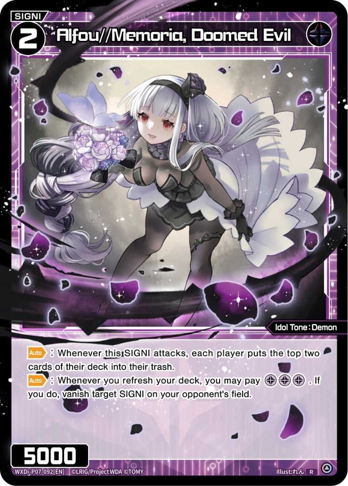

# Alfou//Memoria, Doomed Evil

## Thông tin lá

| Trường | Giá trị |
| --- | --- |
| Mã in | WXDi-P07-092[EN] |
| Set | WXDi-P07[EN] |
| Số thứ tự | 092 |
| Loại thẻ | SIGNI |
| Vị trí | Main Deck |
| Số bản | — (set booster, không áp dụng) |
| Màu | Đen |
| Độ hiếm | R,R(P) |
| Minh họa | れん |
| Level | 2 |
| Limit | — |
| Power | 5000 |
| LRIG type / Class | Idol Tone：Demon |
| Team / Master | — |
| Cost | — |
| Grow cost | — |
| Use timing | — |
| Life Burst | Không |

## Card text chính thức

[Auto]: Whenever this SIGNI attacks, each player puts the top two cards of their deck into their trash.
[Auto]: Whenever you refresh your deck, you may pay {Black} {Black} {Black}. If you do, vanish target SIGNI on your opponent's field.

## Power text / Life Burst

—

## Ghi chú minh họa
Artist: れん. Ảnh R được tải từ Card List tiếng Anh.

## FAQ chính thức

**Q. This SIGNI attacked when there are two cards in my deck and a SIGNI in front of this SIGNI. What happens?**
A. First, when this SIGNI attack, your deck has zero cards by the first [Auto] ability and refreshes your deck. Then, a further second [Auto] ability is triggered and you can pay Ener cost to vanish your opponent's SIGNI. If you vanish the SIGNI in front of this SIGNI by the effect of the second [Auto] ability, you no longer have a SIGNI in front of this SIGNI, so you deal damage to your opponent by attacking.

**Q. During my turn, I refreshed my deck twice; on the second refresh, does the second [Auto] ability trigger?**
A. The second [Auto] ability triggers on the second refresh, but the turn ends if the turn player refreshes twice in the same turn, so the turn ends without resolving that triggered ability.

## Ảnh biến thể

- [R(P)](../images/WXDi-P07-092P-EN.jpg)

## Nguồn
[Card List/FAQ chính thức](https://www.takaratomy.co.jp/products/en.wixoss/card/card.html?card_no=WXDi-P07-092%5BEN%5D ) · [Ảnh thẻ](https://www.takaratomy.co.jp/products/en.wixoss/card/thumb/WXDi-P07-092%5BEN%5D.jpg)
