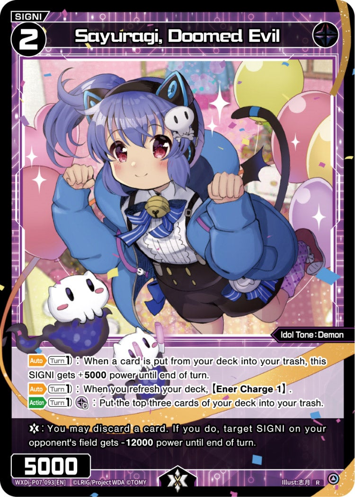

# Sayuragi, Doomed Evil

## Thông tin lá

| Trường | Giá trị |
| --- | --- |
| Mã in | WXDi-P07-093[EN] |
| Set | WXDi-P07[EN] |
| Số thứ tự | 093 |
| Loại thẻ | SIGNI |
| Vị trí | Main Deck |
| Số bản | — (set booster, không áp dụng) |
| Màu | Đen |
| Độ hiếm | R,R(P) |
| Minh họa | 志月 |
| Level | 2 |
| Limit | — |
| Power | 5000 |
| LRIG type / Class | Idol Tone：Demon |
| Team / Master | — |
| Cost | — |
| Grow cost | — |
| Use timing | — |
| Life Burst | Có |

## Card text chính thức

[Auto] {1/Turn}: When a card is put from your deck into your trash, this SIGNI gets +5000 power until end of turn.
[Auto] {1/Turn}: When you refresh your deck, 【Ener Charge 1】.
[Action] {1/Turn} {Blackx0}: Put the top three cards of your deck into your trash.

## Power text / Life Burst

You may discard a card. If you do, target SIGNI on your opponent's field gets -12000 power until end of turn.

## Ghi chú minh họa
Artist: 志月. Ảnh R được tải từ Card List tiếng Anh.

## FAQ chính thức

**Q. If I use this SIGNI's [Action] ability, does the first [Auto] ability trigger?**
A. Yes, it triggers; it triggers three times because three cards were put into your trash, but only once because of the ability to have a once per turn limit.

## Ảnh biến thể

- [R(P)](../images/WXDi-P07-093P-EN.jpg)

## Nguồn
[Card List/FAQ chính thức](https://www.takaratomy.co.jp/products/en.wixoss/card/card.html?card_no=WXDi-P07-093%5BEN%5D ) · [Ảnh thẻ](https://www.takaratomy.co.jp/products/en.wixoss/card/thumb/WXDi-P07-093%5BEN%5D.jpg)
