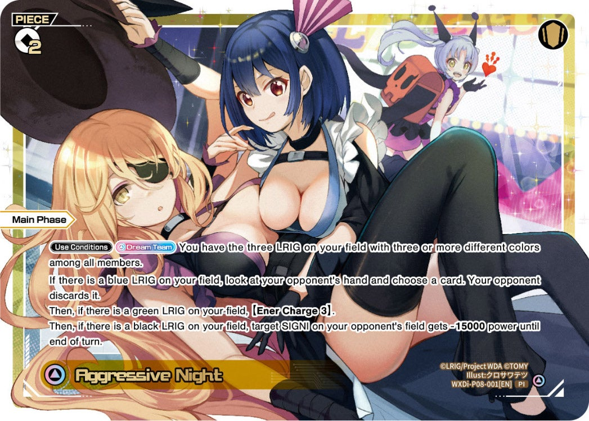

# Aggressive Night

## Thông tin lá

| Trường | Giá trị |
| --- | --- |
| Mã in | WXDi-P08-001[EN] |
| Set | WXDi-P08[EN] |
| Số thứ tự | 001 |
| Loại thẻ | PIECE |
| Vị trí | LRIG Deck |
| Số bản | — (set booster, không áp dụng) |
| Màu | Trắng |
| Độ hiếm | PI,LRP |
| Minh họa | クロサワテツ |
| Level | — |
| Limit | — |
| Power | 0 |
| LRIG type / Class | — |
| Team / Master | — |
| Cost | 《C》×２ |
| Grow cost | — |
| Use timing | Main Phase |
| Life Burst | Không |

## Card text chính thức

[Use Conditions] [Dream Team] You have the three LRIG on your field with three or more different colors among all members.

If there is a blue LRIG on your field, look at your opponent's hand and choose a card. Your opponent discards it.
Then, if there is a green LRIG on your field, 【Ener Charge 3】.
Then, if there is a black LRIG on your field, target SIGNI on your opponent's field gets -15000 power until end of turn.

## Power text / Life Burst

—

## Ghi chú minh họa
Artist: クロサワテツ. Ảnh PI được tải từ Card List tiếng Anh.

## FAQ chính thức

**Q. What is [Dream Team]?**
A. [Dream Team] is a PIECE that can be used if certain conditions listed there are met. Note that PIECE with [Dream Team] icon cannot be put in the LRIG deck together with PIECE with [Team] and [Dream Team] icons. (= total limit of one PIECE). For example, if you include one PIECE with [Dream Team] icon, you can only include another PIECE with neither icon.

**Q. May this PIECE be used if the colors of my three LRIG are blue, green, and black?**
A. No, you can't even put it in your deck to begin with. This PIECE is of the white color, and you can only put cards of your LRIG's color in your LRIG deck and main deck.

**Q. If there are blue and black LRIG on my field, may I choose a SIGNI to decrease with the black LRIG's effect after looking my opponent's hand with the blue LRIG's effect?**
A. Yes, choosing targets for effects when there is a black LRIG occurs immediately before that effect triggers, and after the effect of a blue LRIG.

## Ảnh biến thể

- [LRP](../images/WXDi-P08-001P-EN.jpg)

## Nguồn
[Card List/FAQ chính thức](https://www.takaratomy.co.jp/products/en.wixoss/card/card.html?card_no=WXDi-P08-001%5BEN%5D ) · [Ảnh thẻ](https://www.takaratomy.co.jp/products/en.wixoss/card/thumb/WXDi-P08-001%5BEN%5D.jpg)
