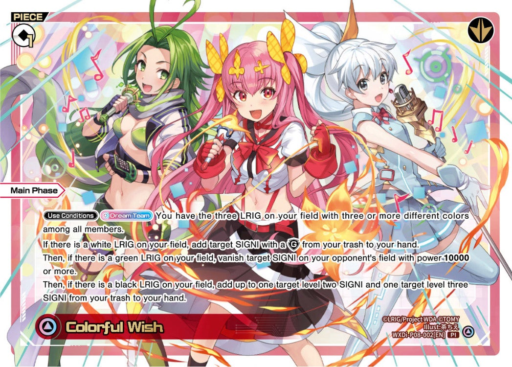

# Colorful Wish

## Thông tin lá

| Trường | Giá trị |
| --- | --- |
| Mã in | WXDi-P08-002[EN] |
| Set | WXDi-P08[EN] |
| Số thứ tự | 002 |
| Loại thẻ | PIECE |
| Vị trí | LRIG Deck |
| Số bản | — (set booster, không áp dụng) |
| Màu | Đỏ |
| Độ hiếm | PI,LRP |
| Minh họa | 茶ちえ |
| Level | — |
| Limit | — |
| Power | 0 |
| LRIG type / Class | — |
| Team / Master | — |
| Cost | 《C》×１ |
| Grow cost | — |
| Use timing | Main Phase |
| Life Burst | Không |

## Card text chính thức

[Use Conditions] [Dream Team] You have the three LRIG on your field with three or more different colors among all members.

If there is a white LRIG on your field, add target SIGNI with a {Guard Icon} from your trash to your hand.
Then, if there is a green LRIG on your field, vanish target SIGNI on your opponent's field with power 10000 or more.
Then, if there is a black LRIG on your field, add up to one target level two SIGNI and one target level three SIGNI from your trash to your hand.

## Power text / Life Burst

—

## Ghi chú minh họa
Artist: 茶ちえ. Ảnh PI được tải từ Card List tiếng Anh.

## FAQ chính thức

**Q. What is [Dream Team]?**
A. [Dream Team] is a PIECE that can be used if certain conditions listed there are met. Note that PIECE with [Dream Team] icon cannot be put in the LRIG deck together with PIECE with [Team] and [Dream Team] icons. (= total limit of one PIECE). For example, if you include one PIECE with [Dream Team] icon, you can only include another PIECE with neither icon.

**Q. May this PIECE be used if the colors of my three LRIG are white, green, and black?**
A. No, you can't even put it in your deck to begin with. This PIECE is of the redcolor, and you can only put cards of your LRIG's color in your LRIG deck and main deck.

**Q. If I use this PIECE while I have green and black LRIG on my field, and vanish my opponent's SIGNI with the green effect, and that SIGNI had an [Auto] ability when it was vanished, which effect is resolved first, the [Auto] ability or the black effect of this PIECE?**
A. The effect of this PIECE resolves first. The triggered [Auto] ability will not be resolved during the effect's resolution, so this PIECE's effect is resolved first, until it is completed.

## Ảnh biến thể

- [LRP](../images/WXDi-P08-002P-EN.jpg)

## Nguồn
[Card List/FAQ chính thức](https://www.takaratomy.co.jp/products/en.wixoss/card/card.html?card_no=WXDi-P08-002%5BEN%5D ) · [Ảnh thẻ](https://www.takaratomy.co.jp/products/en.wixoss/card/thumb/WXDi-P08-002%5BEN%5D.jpg)
