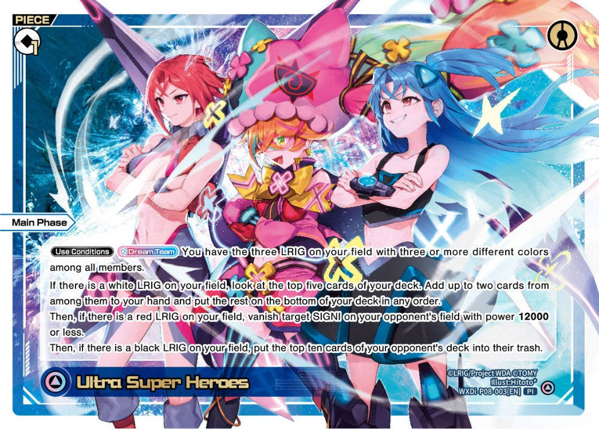

# Ultra Super Heroes

## Thông tin lá

| Trường | Giá trị |
| --- | --- |
| Mã in | WXDi-P08-003[EN] |
| Set | WXDi-P08[EN] |
| Số thứ tự | 003 |
| Loại thẻ | PIECE |
| Vị trí | LRIG Deck |
| Số bản | — (set booster, không áp dụng) |
| Màu | Xanh dương |
| Độ hiếm | PI,LRP |
| Minh họa | Hitoto* |
| Level | — |
| Limit | — |
| Power | 0 |
| LRIG type / Class | — |
| Team / Master | — |
| Cost | 《C》×１ |
| Grow cost | — |
| Use timing | Main Phase |
| Life Burst | Không |

## Card text chính thức

[Use Conditions] [Dream Team] You have the three LRIG on your field with three or more different colors among all members.

If there is a white LRIG on your field, look at the top five cards of your deck. Add up to two cards from among them to your hand and put the rest on the bottom of your deck in any order.
Then, if there is a red LRIG on your field, vanish target SIGNI on your opponent's field with power 12000 or less.
Then, if there is a black LRIG on your field, put the top ten cards of your opponent's deck into their trash.

## Power text / Life Burst

—

## Ghi chú minh họa
Artist: Hitoto*. Ảnh PI được tải từ Card List tiếng Anh.

## FAQ chính thức

**Q. What is [Dream Team]?**
A. [Dream Team] is a PIECE that can be used if certain conditions listed there are met. Note that PIECE with [Dream Team] icon cannot be put in the LRIG deck together with PIECE with [Team] and [Dream Team] icons. (= total limit of one PIECE). For example, if you include one PIECE with [Dream Team] icon, you can only include another PIECE with neither icon.

**Q. May I choose not to target 《Rei//Memoria, Natural Crystal》 with the ability of 《Akino, Bound for Tomorrow》, which is my LRIG card, if I have not discarded a white SIGNI to the trash or paid Ener cost, even if 《Rei//Memoria, Natural Crystal》 is on your opponent's field, at the beginning of my main phase?**
A. No, the [Auto] ability of 《Akino, Bound for Tomorrow》 chooses its target first. In the case of abilities like 《Akino, Bound for Tomorrow》 where you choose the target first, then pay the cost and process the effect, you must choose a target if you choose to pay the cost.

**Q. May this PIECE be used if the colors of my three LRIG are white, red, and black?**
A. No, you can't even put it in your deck to begin with. This PIECE is of the blue color, and you can only put cards of your LRIG's color in your LRIG deck and main deck.

**Q. What happens to the [Auto] ability if this SIGNI becomes a target of an effect that "vanish" it or causes it to "lose its abilities"?**
A. In that case, the ability will trigger when it becomes the target. After that, even if 《Rei//Memoria, Natural Crystal》 is vanished or loses its abilities by the effect, the ability that is already triggered will still resolve.

**Q. May I choose not to target 《Rei//Memoria, Natural Crystal》 with the ability of 《Rei, On the Wings of Supremacy》, which is my LRIG card, if there are no conditions met such as "if you have drawn two or more cards by effects this turn" even if 《Rei//Memoria, Natural Crystal》 is on your opponent's field, at the beginning of my attack phase?**
A. Yes, in that case you may choose not to target 《Rei//Memoria, Natural Crystal》. The ability of 《Rei//On the Wings of Supremacy》 has a condition such as "if you have drawn two or more cards by effects this turn" before selecting a target. Check the condition, and if it is met, select a target, pay the cost, and process the effect. So, if the condition is not met, you will not select a target. However, if the condition is met, you must select a target.

**Q. If I have white and red LRIGs on my field, may I choose a SIGNI to vanish with the red LRIG's effect after choosing a card to add to my hand with the white LRIG's effect?**
A. Yes, choosing targets for effects when there is a red LRIG occurs immediately before that effect triggers, and after the effect of a white LRIG. However, effects are processed in order from top to bottom, so you cannot choose targets for the effect of the red LRIG after processing the effect of the black LRIG and checking its result.

## Ảnh biến thể

- [LRP](../images/WXDi-P08-003P-EN.jpg)

## Nguồn
[Card List/FAQ chính thức](https://www.takaratomy.co.jp/products/en.wixoss/card/card.html?card_no=WXDi-P08-003%5BEN%5D ) · [Ảnh thẻ](https://www.takaratomy.co.jp/products/en.wixoss/card/thumb/WXDi-P08-003%5BEN%5D.jpg)
