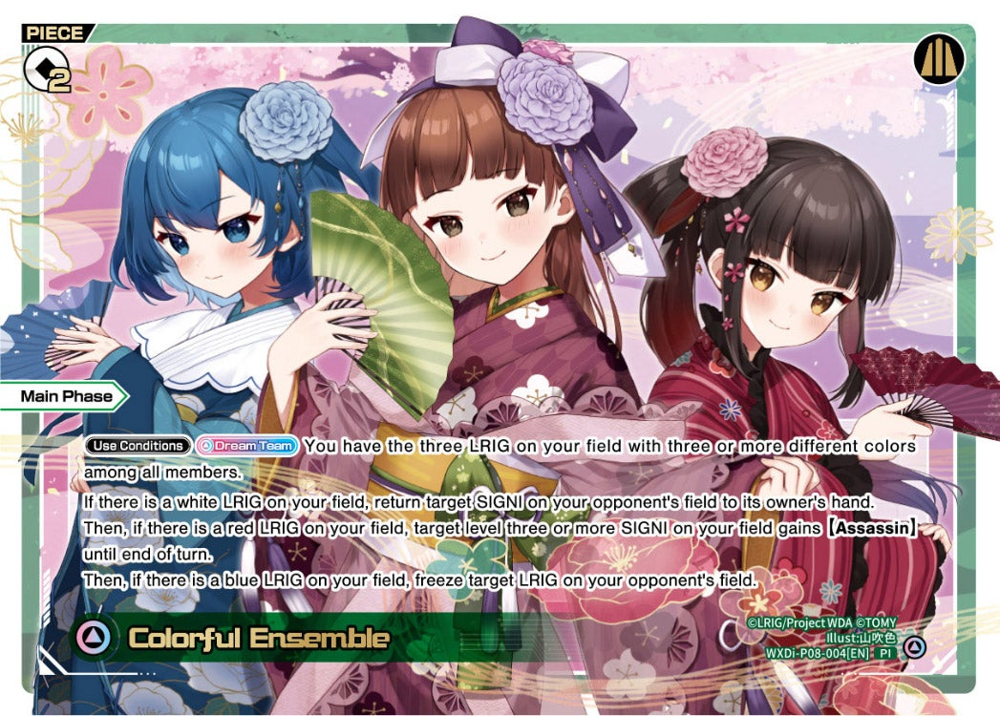

# Colorful Ensemble

## Thông tin lá

| Trường | Giá trị |
| --- | --- |
| Mã in | WXDi-P08-004[EN] |
| Set | WXDi-P08[EN] |
| Số thứ tự | 004 |
| Loại thẻ | PIECE |
| Vị trí | LRIG Deck |
| Số bản | — (set booster, không áp dụng) |
| Màu | Xanh lá |
| Độ hiếm | PI,LRP |
| Minh họa | 山吹色 |
| Level | — |
| Limit | — |
| Power | 0 |
| LRIG type / Class | — |
| Team / Master | — |
| Cost | 《C》×２ |
| Grow cost | — |
| Use timing | Main Phase |
| Life Burst | Không |

## Card text chính thức

[Use Conditions] [Dream Team] You have the three LRIG on your field with three or more different colors among all members.

If there is a white LRIG on your field, return target SIGNI on your opponent's field to its owner's hand.
Then, if there is a red LRIG on your field, target level three or more SIGNI on your field gains 【Assassin】 until end of turn.
Then, if there is a blue LRIG on your field, freeze target LRIG on your opponent's field.

## Power text / Life Burst

—

## Ghi chú minh họa
Artist: 山吹色. Ảnh PI được tải từ Card List tiếng Anh.

## FAQ chính thức

**Q. What is [Dream Team]?**
A. [Dream Team] is a PIECE that can be used if certain conditions listed there are met. Note that PIECE with [Dream Team] icon cannot be put in the LRIG deck together with PIECE with [Team] and [Dream Team] icons. (= total limit of one PIECE). For example, if you include one PIECE with [Dream Team] icon, you can only include another PIECE with neither icon.

**Q. May this PIECE be used if the colors of my three LRIG are white, red, and blue?**
A. No, you can't even put it in your deck to begin with. This PIECE is of the green color, and you can only put cards of your LRIG's color in your LRIG deck and main deck.

## Ảnh biến thể

- [LRP](../images/WXDi-P08-004P-EN.jpg)

## Nguồn
[Card List/FAQ chính thức](https://www.takaratomy.co.jp/products/en.wixoss/card/card.html?card_no=WXDi-P08-004%5BEN%5D ) · [Ảnh thẻ](https://www.takaratomy.co.jp/products/en.wixoss/card/thumb/WXDi-P08-004%5BEN%5D.jpg)
