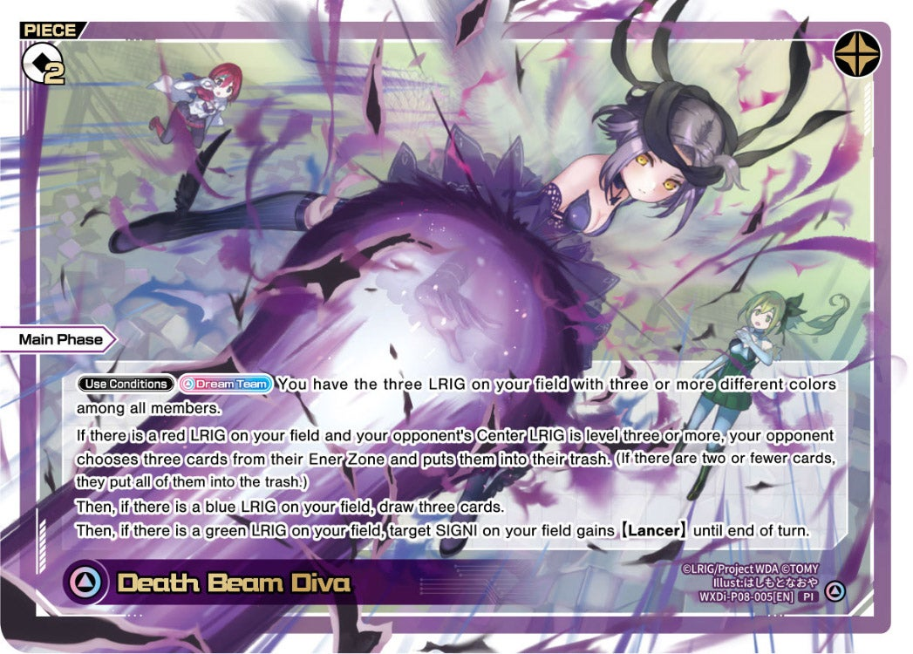

# Death Beam Diva

## Thông tin lá

| Trường | Giá trị |
| --- | --- |
| Mã in | WXDi-P08-005[EN] |
| Set | WXDi-P08[EN] |
| Số thứ tự | 005 |
| Loại thẻ | PIECE |
| Vị trí | LRIG Deck |
| Số bản | — (set booster, không áp dụng) |
| Màu | Đen |
| Độ hiếm | PI,LRP |
| Minh họa | はしもとなおや |
| Level | — |
| Limit | — |
| Power | 0 |
| LRIG type / Class | — |
| Team / Master | — |
| Cost | 《C》×２ |
| Grow cost | — |
| Use timing | Main Phase |
| Life Burst | Không |

## Card text chính thức

[Use Conditions] [Dream Team] You have the three LRIG on your field with three or more different colors among all members.

If there is a red LRIG on your field and your opponent's Center LRIG is level three or more, your opponent chooses three cards from their Ener Zone and puts them into their trash. (If there are two or fewer cards, they put all of them into the trash.)
Then, if there is a blue LRIG on your field, draw three cards.
Then, if there is a green LRIG on your field, target SIGNI on your field gains 【Lancer】 until end of turn.

## Power text / Life Burst

—

## Ghi chú minh họa
Artist: はしもとなおや. Ảnh PI được tải từ Card List tiếng Anh.

## FAQ chính thức

**Q. What is [Dream Team]?**
A. [Dream Team] is a PIECE that can be used if certain conditions listed there are met. Note that PIECE with [Dream Team] icon cannot be put in the LRIG deck together with PIECE with [Team] and [Dream Team] icons. (= total limit of one PIECE). For example, if you include one PIECE with [Dream Team] icon, you can only include another PIECE with neither icon.

**Q. May this PIECE be used if the colors of my three LRIG are red, blue, and green?**
A. No, you can't even put it in your deck to begin with. This PIECE is of the black color, and you can only put cards of your LRIG's color in your LRIG deck and main deck.

**Q. If I have red and green LRIG on my field, may I choose a SIGNI to give [Lancer] to with the green effect after my opponent selects which card to put from their Ener zone into their owner's trash with the red effect?**
A. Yes, selecting a target for the green LRIG's effect occurs immediately before that effect triggers, after the effect of the red LRIG.

## Ảnh biến thể

- [LRP](../images/WXDi-P08-005P-EN.jpg)

## Nguồn
[Card List/FAQ chính thức](https://www.takaratomy.co.jp/products/en.wixoss/card/card.html?card_no=WXDi-P08-005%5BEN%5D ) · [Ảnh thẻ](https://www.takaratomy.co.jp/products/en.wixoss/card/thumb/WXDi-P08-005%5BEN%5D.jpg)
