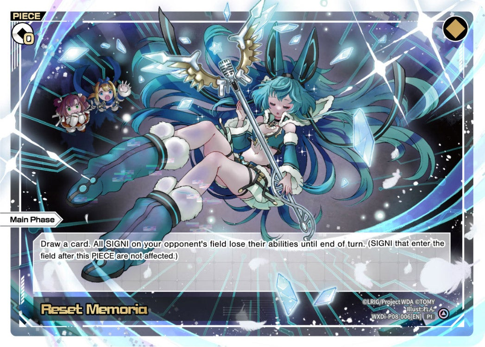

# Reset Memoria

## Thông tin lá

| Trường | Giá trị |
| --- | --- |
| Mã in | WXDi-P08-006[EN] |
| Set | WXDi-P08[EN] |
| Số thứ tự | 006 |
| Loại thẻ | PIECE |
| Vị trí | LRIG Deck |
| Số bản | — (set booster, không áp dụng) |
| Màu | Không màu |
| Độ hiếm | PI,LRP |
| Minh họa | れん |
| Level | — |
| Limit | — |
| Power | 0 |
| LRIG type / Class | — |
| Team / Master | — |
| Cost | 《C》×０ |
| Grow cost | — |
| Use timing | Main Phase |
| Life Burst | Không |

## Card text chính thức

Draw a card. All SIGNI on your opponent's field lose their abilities until end of turn. (SIGNI that enter the field after this PIECE are not affected.)

## Power text / Life Burst

—

## Ghi chú minh họa
Artist: れん. Ảnh PI được tải từ Card List tiếng Anh.

## FAQ chính thức

**Q. If a SIGNI with an [Auto] ability triggered at the end of the turn has its ability negated until the end of turn by this PIECE's effect, does the [Auto] ability still trigger at the end of turn?**
A. No, it will not trigger. During the end phase, first, (1) [Auto] abilities that trigger at the end of the turn will trigger, (2) the turn player discards cards from their hand to six if they have seven or more, and (3) effects that last until the end of the turn end. This card's effect lasts until (3), so any [Auto] abilities that were lost at (1) will not trigger.

## Ảnh biến thể

- [LRP](../images/WXDi-P08-006P-EN.jpg)

## Nguồn
[Card List/FAQ chính thức](https://www.takaratomy.co.jp/products/en.wixoss/card/card.html?card_no=WXDi-P08-006%5BEN%5D ) · [Ảnh thẻ](https://www.takaratomy.co.jp/products/en.wixoss/card/thumb/WXDi-P08-006%5BEN%5D.jpg)
