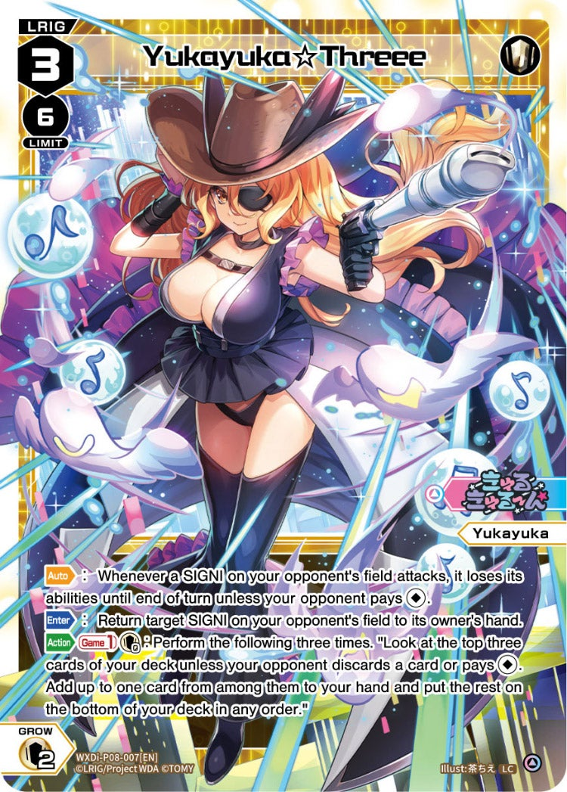

# Yukayuka☆Threee

## Thông tin lá

| Trường | Giá trị |
| --- | --- |
| Mã in | WXDi-P08-007[EN] |
| Set | WXDi-P08[EN] |
| Số thứ tự | 007 |
| Loại thẻ | LRIG |
| Vị trí | LRIG Deck |
| Số bản | — (set booster, không áp dụng) |
| Màu | Trắng |
| Độ hiếm | LC,LR,LRP,UR |
| Minh họa | 茶ちえ |
| Level | 3 |
| Limit | 6 |
| Power | 0 |
| LRIG type / Class | Yukayuka |
| Team / Master | Kyurukyurun☆ |
| Cost | — |
| Grow cost | 《W》×２ |
| Use timing | — |
| Life Burst | Không |

## Card text chính thức

[Auto]: Whenever a SIGNI on your opponent's field attacks, it loses its abilities until end of turn unless your opponent pays {Colorless}.
[Enter]: Return target SIGNI on your opponent's field to its owner's hand.
[Action] {1/Game} {Whitex0}: Perform the following three times. "Look at the top three cards of your deck unless your opponent discards a card or pays {Colorless}. Add up to one card from among them to your hand and put the rest on the bottom of your deck in any order."

## Power text / Life Burst

—

## Ghi chú minh họa
Artist: 茶ちえ. Ảnh LC được tải từ Card List tiếng Anh.

## FAQ chính thức

**Q. My opponent's SIGNI with an [Auto] ability triggering "whenever this SIGNI attacks" attacked. Which [Auto] ability will trigger first, the this LRIG or the attacking SIGNI's ability?**
A. The [Auto] ability of your opponent's SIGNI that triggers "whenever this SIGNI attacks" as the turn player attacks will trigger first. If that SIGNI gains the ability due to its [Auto] ability, it will then lose that ability by the [Auto] ability of "Yukayuka☆Threee", which triggers next. However, if the effect was to get power, that power modification will not be lost.

**Q. When I use the [Action] ability, if my opponent has no cards in hand, may they choose to "discard a card from their hand" to make the effect result in nothing happening?**
A. No, it is not possible. In this case, since your opponent did not discard a card, the latter half of the effect will be applied if they do not pay the cost with {Colorless}.

## Ảnh biến thể

- [LRP](../images/WXDi-P08-007P-EN.jpg)
- [LR](../images/WXDi-P08-007R-EN.jpg)
- [UR](../images/WXDi-P08-007U-EN.jpg)

## Nguồn
[Card List/FAQ chính thức](https://www.takaratomy.co.jp/products/en.wixoss/card/card.html?card_no=WXDi-P08-007%5BEN%5D ) · [Ảnh thẻ](https://www.takaratomy.co.jp/products/en.wixoss/card/thumb/WXDi-P08-007%5BEN%5D.jpg)
