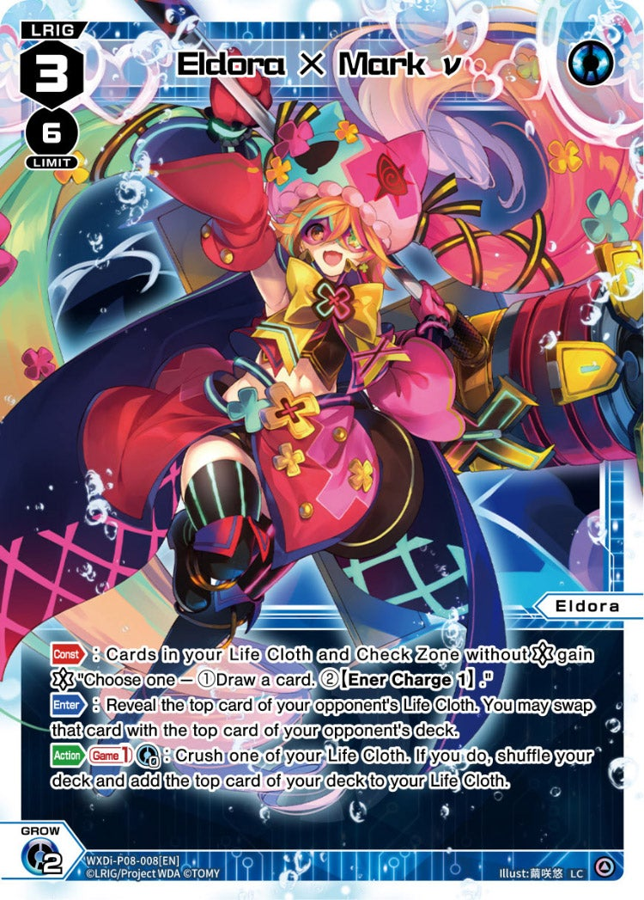

# Eldora × Mark ν

## Thông tin lá

| Trường | Giá trị |
| --- | --- |
| Mã in | WXDi-P08-008[EN] |
| Set | WXDi-P08[EN] |
| Số thứ tự | 008 |
| Loại thẻ | LRIG |
| Vị trí | LRIG Deck |
| Số bản | — (set booster, không áp dụng) |
| Màu | Xanh dương |
| Độ hiếm | LC,LR,LRP,UR |
| Minh họa | 繭咲悠 / イチゼン |
| Level | 3 |
| Limit | 6 |
| Power | 0 |
| LRIG type / Class | Eldora |
| Team / Master | — |
| Cost | — |
| Grow cost | 《U》×２ |
| Use timing | — |
| Life Burst | Không |

## Card text chính thức

[Constant]: Cards in your Life Cloth and Check Zone without 【Life Burst】 gain 【Life Burst】 "Choose one — ①Draw a card. ②【Ener Charge 1】."
[Enter]: Reveal the top card of your opponent's Life Cloth. You may swap that card with the top card of your opponent's deck.
[Action] {1/Game} {Bluex0}: Crush one of your Life Cloth. If you do, shuffle your deck and add the top card of your deck to your Life Cloth.

## Power text / Life Burst

—

## Ghi chú minh họa
Artist: 繭咲悠 / イチゼン. Ảnh LC được tải từ Card List tiếng Anh.

## FAQ chính thức

**Q. If you use an [Enter] ability to swap my opponent's Life Cloth and the top card of their deck, are they face up?**
A. No, they will be face down. Although they are revealed face-up by the effect, please turn them back face-down after the swap.

**Q. Will the Life Burst of a card that is crushed by this [Action] ability trigger?**
A. Yes, the Life Burst will trigger. First, the effect of this [Action] ability is resolved up to adding the last Life Cloth, then the waiting Life Burst is resolved.

**Q. What happens to the [Enter] ability if my opponent has no Life Cloth or no cards in their deck?**
A. You can reveal the top card of the remaining side, but as one side does not exist, you cannot swap them.

## Ảnh biến thể

- [LRP](../images/WXDi-P08-008P-EN.jpg)
- [LR](../images/WXDi-P08-008R-EN.jpg)
- [UR](../images/WXDi-P08-008U-EN.jpg)

## Nguồn
[Card List/FAQ chính thức](https://www.takaratomy.co.jp/products/en.wixoss/card/card.html?card_no=WXDi-P08-008%5BEN%5D ) · [Ảnh thẻ](https://www.takaratomy.co.jp/products/en.wixoss/card/thumb/WXDi-P08-008%5BEN%5D.jpg)
