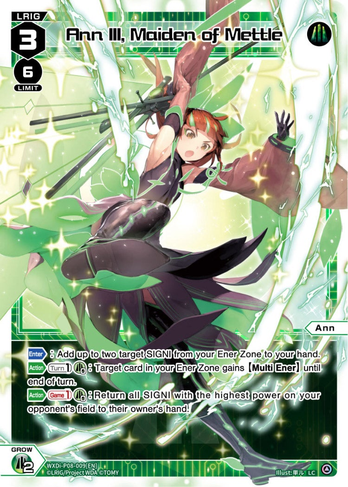

# Ann III, Maiden of Mettle

## Thông tin lá

| Trường | Giá trị |
| --- | --- |
| Mã in | WXDi-P08-009[EN] |
| Set | WXDi-P08[EN] |
| Số thứ tự | 009 |
| Loại thẻ | LRIG |
| Vị trí | LRIG Deck |
| Số bản | — (set booster, không áp dụng) |
| Màu | Xanh lá |
| Độ hiếm | LC,LR,LRP,UR |
| Minh họa | 単ル
かわすみ |
| Level | 3 |
| Limit | 6 |
| Power | 0 |
| LRIG type / Class | Ann |
| Team / Master | — |
| Cost | — |
| Grow cost | 《G》×２ |
| Use timing | — |
| Life Burst | Không |

## Card text chính thức

[Enter]: Add up to two target SIGNI from your Ener Zone to your hand.
[Action] {1/Turn} {Greenx0}: Target card in your Ener Zone gains 【Multi Ener】 until end of turn.
[Action] {1/Game} {Greenx0}: Return all SIGNI with the highest power on your opponent's field to their owner's hand.

## Power text / Life Burst

—

## Ghi chú minh họa
Artist: 単ル
かわすみ. Ảnh LC được tải từ Card List tiếng Anh.

## FAQ chính thức

**Q. May I return a SIGNI with [Shadow] to its owner's hand with the second [Action] ability?**
A. Yes, you can return a SIGNI with [Shadow] to your hand if it meets the conditions. This ability does not target, so [Shadow] does not affect it.

## Ảnh biến thể

- [LRP](../images/WXDi-P08-009P-EN.jpg)
- [LR](../images/WXDi-P08-009R-EN.jpg)
- [UR](../images/WXDi-P08-009U-EN.jpg)

## Nguồn
[Card List/FAQ chính thức](https://www.takaratomy.co.jp/products/en.wixoss/card/card.html?card_no=WXDi-P08-009%5BEN%5D ) · [Ảnh thẻ](https://www.takaratomy.co.jp/products/en.wixoss/card/thumb/WXDi-P08-009%5BEN%5D.jpg)
