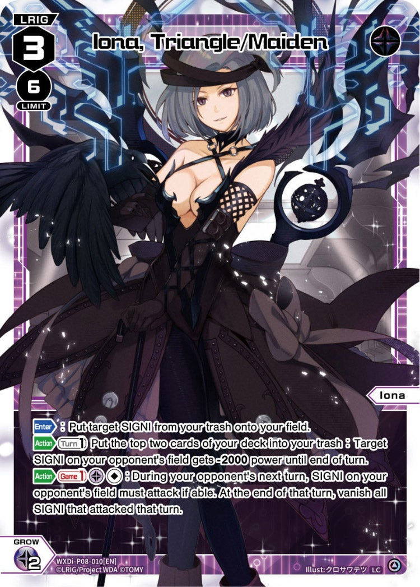

# Iona, Triangle/Maiden

## Thông tin lá

| Trường | Giá trị |
| --- | --- |
| Mã in | WXDi-P08-010[EN] |
| Set | WXDi-P08[EN] |
| Số thứ tự | 010 |
| Loại thẻ | LRIG |
| Vị trí | LRIG Deck |
| Số bản | — (set booster, không áp dụng) |
| Màu | Đen |
| Độ hiếm | LC,LR,LRP,UR |
| Minh họa | クロサワテツ |
| Level | 3 |
| Limit | 6 |
| Power | 0 |
| LRIG type / Class | Iona |
| Team / Master | — |
| Cost | — |
| Grow cost | 《B》×２ |
| Use timing | — |
| Life Burst | Không |

## Card text chính thức

[Enter]: Put target SIGNI from your trash onto your field.
[Action] {1/Turn} Put the top two cards of your deck into your trash: Target SIGNI on your opponent's field gets -2000 power until end of turn.
[Action] {1/Game} {Black} {Colorless}: During your opponent's next turn, SIGNI on your opponent's field must attack if able. At the end of that turn, vanish all SIGNI that attacked that turn.

## Power text / Life Burst

—

## Ghi chú minh họa
Artist: クロサワテツ. Ảnh LC được tải từ Card List tiếng Anh.

## FAQ chính thức

**Q. May the first [Action] ability be used when there is only one card left in my deck?**
A. No, you cannot use it because you cannot pay the cost.

**Q. Does the attack order of the three SIGNI on my opponent's field during the next turn after using the second [Action] ability predetermined?**
A. Your opponent can choose the order to attack among the three required SIGNI if there are three of them.

**Q. Do I need to attack again if my opponent's SIGNI attacked and then stood up during their turn after I used the second [Action] ability?**
A. Yes, that SIGNI must attack again. A SIGNI that is forced to attack cannot end the SIGNI attack step while still being able to attack.

**Q. Does the second [Action] ability have to attack even the SIGNI that put the my opponent's field after it was used?**
A. Yes, regardless of when they put on your opponent's field, on the next turn of your opponent in which this [Action] ability was used, the SIGNI on your opponent's field must be affected by this effect and attacked.

## Ảnh biến thể

- [LRP](../images/WXDi-P08-010P-EN.jpg)
- [LR](../images/WXDi-P08-010R-EN.jpg)
- [UR](../images/WXDi-P08-010U-EN.jpg)

## Nguồn
[Card List/FAQ chính thức](https://www.takaratomy.co.jp/products/en.wixoss/card/card.html?card_no=WXDi-P08-010%5BEN%5D ) · [Ảnh thẻ](https://www.takaratomy.co.jp/products/en.wixoss/card/thumb/WXDi-P08-010%5BEN%5D.jpg)
