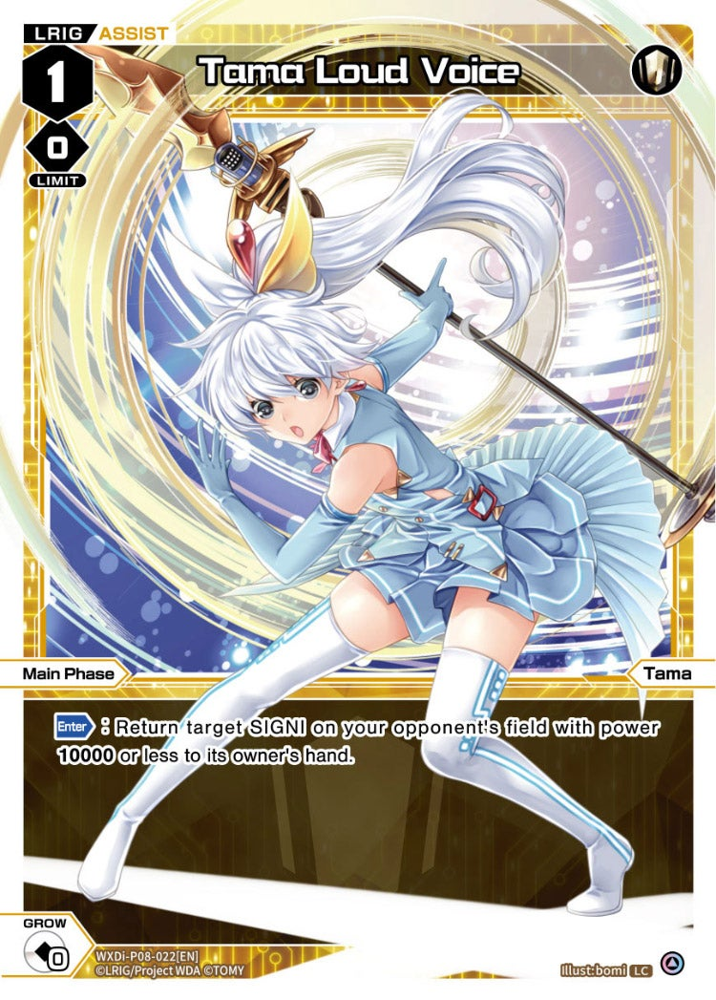

# Tama Loud Voice

## Thông tin lá

| Trường | Giá trị |
| --- | --- |
| Mã in | WXDi-P08-022[EN] |
| Set | WXDi-P08[EN] |
| Số thứ tự | 022 |
| Loại thẻ | ASSIST LRIG |
| Vị trí | LRIG Deck |
| Số bản | — (set booster, không áp dụng) |
| Màu | Trắng |
| Độ hiếm | LC,LC(P) |
| Minh họa | bomi |
| Level | 1 |
| Limit | 0 |
| Power | 0 |
| LRIG type / Class | Tama |
| Team / Master | — |
| Cost | — |
| Grow cost | 《C》×０ |
| Use timing | Main Phase |
| Life Burst | Không |

## Card text chính thức

[Enter]: Return target SIGNI on your opponent's field with power 10000 or less to its owner's hand.

## Power text / Life Burst

—

## Ghi chú minh họa
Artist: bomi. Ảnh LC được tải từ Card List tiếng Anh.

## FAQ chính thức

**Q. Does the [Enter] ability must trigger?**
A. Yes, the [Enter] ability without cost is must triggered.
The effect must target and process if there is a SIGNI on your opponent's field that meets the conditions.

## Ảnh biến thể

- [LC(P)](../images/WXDi-P08-022P-EN.jpg)

## Nguồn
[Card List/FAQ chính thức](https://www.takaratomy.co.jp/products/en.wixoss/card/card.html?card_no=WXDi-P08-022%5BEN%5D ) · [Ảnh thẻ](https://www.takaratomy.co.jp/products/en.wixoss/card/thumb/WXDi-P08-022%5BEN%5D.jpg)
