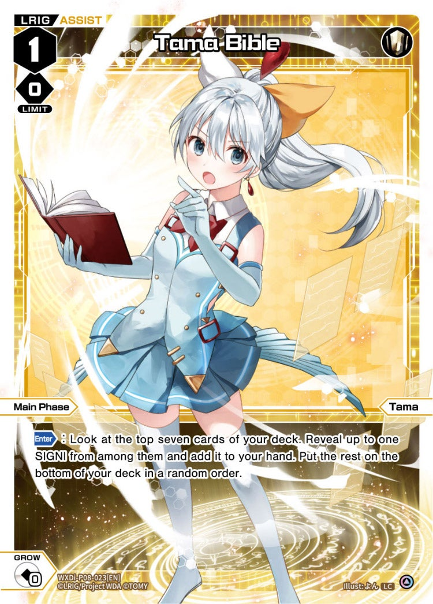

# Tama Bible

## Thông tin lá

| Trường | Giá trị |
| --- | --- |
| Mã in | WXDi-P08-023[EN] |
| Set | WXDi-P08[EN] |
| Số thứ tự | 023 |
| Loại thẻ | ASSIST LRIG |
| Vị trí | LRIG Deck |
| Số bản | — (set booster, không áp dụng) |
| Màu | Trắng |
| Độ hiếm | LC,LC(P) |
| Minh họa | よん |
| Level | 1 |
| Limit | 0 |
| Power | 0 |
| LRIG type / Class | Tama |
| Team / Master | — |
| Cost | — |
| Grow cost | 《C》×０ |
| Use timing | Main Phase |
| Life Burst | Không |

## Card text chính thức

[Enter]: Look at the top seven cards of your deck. Reveal up to one SIGNI from among them and add it to your hand. Put the rest on the bottom of your deck in a random order.

## Power text / Life Burst

—

## Ghi chú minh họa
Artist: よん. Ảnh LC được tải từ Card List tiếng Anh.

## FAQ chính thức

**Q. Does the [Enter] ability must trigger? Also, what happens if my deck has seven cards or less?**
A. Yes, the [Enter] ability without cost is must triggered. If your deck has seven cards or less, you must process the effect by looking at the remaining deck. If a card is put at the bottom of your deck after processing, no refresh will occur.

## Ảnh biến thể

- [LC(P)](../images/WXDi-P08-023P-EN.jpg)

## Nguồn
[Card List/FAQ chính thức](https://www.takaratomy.co.jp/products/en.wixoss/card/card.html?card_no=WXDi-P08-023%5BEN%5D ) · [Ảnh thẻ](https://www.takaratomy.co.jp/products/en.wixoss/card/thumb/WXDi-P08-023%5BEN%5D.jpg)
