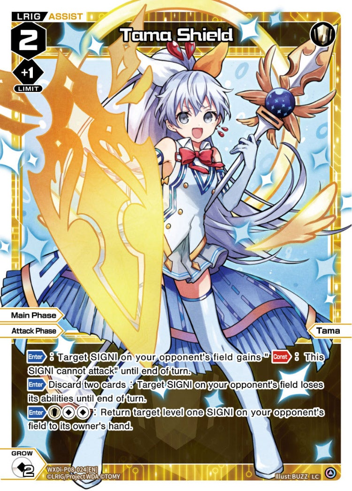

# Tama Shield

## Thông tin lá

| Trường | Giá trị |
| --- | --- |
| Mã in | WXDi-P08-024[EN] |
| Set | WXDi-P08[EN] |
| Số thứ tự | 024 |
| Loại thẻ | ASSIST LRIG |
| Vị trí | LRIG Deck |
| Số bản | — (set booster, không áp dụng) |
| Màu | Trắng |
| Độ hiếm | LC,LC(P) |
| Minh họa | BUZZ |
| Level | 2 |
| Limit | ＋１ |
| Power | 0 |
| LRIG type / Class | Tama |
| Team / Master | — |
| Cost | — |
| Grow cost | 《C》×２ |
| Use timing | Main Phase
Attack Phase |
| Life Burst | Không |

## Card text chính thức

[Enter]: Target SIGNI on your opponent's field gains "[Constant]: This SIGNI cannot attack" until end of turn.
[Enter] Discard two cards: Target SIGNI on your opponent's field loses its abilities until end of turn.
[Enter] {White} {Colorless} {Colorless}: Return target level one SIGNI on your opponent's field to its owner's hand.

## Power text / Life Burst

—

## Ghi chú minh họa
Artist: BUZZ. Ảnh LC được tải từ Card List tiếng Anh.

## FAQ chính thức

**Q. Is the order of triggering the three [Enter] abilities arbitrary?**
A. Yes, you can trigger each of them when this LRIG put on your field and trigger them in any order you like. However, please note that if you target the same SIGNI with the first and second [Enter] abilities and resolve the first ability first, the effect of "[Const]: This SIGNI cannot attack" granted by the first ability will be lost by the second ability, so please be careful.

## Ảnh biến thể

- [LC(P)](../images/WXDi-P08-024P-EN.jpg)

## Nguồn
[Card List/FAQ chính thức](https://www.takaratomy.co.jp/products/en.wixoss/card/card.html?card_no=WXDi-P08-024%5BEN%5D ) · [Ảnh thẻ](https://www.takaratomy.co.jp/products/en.wixoss/card/thumb/WXDi-P08-024%5BEN%5D.jpg)
