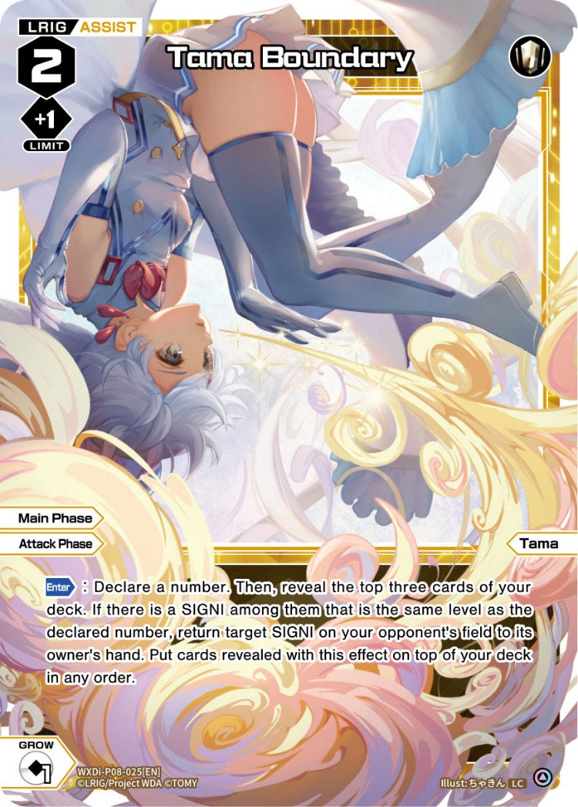

# Tama Boundary

## Thông tin lá

| Trường | Giá trị |
| --- | --- |
| Mã in | WXDi-P08-025[EN] |
| Set | WXDi-P08[EN] |
| Số thứ tự | 025 |
| Loại thẻ | ASSIST LRIG |
| Vị trí | LRIG Deck |
| Số bản | — (set booster, không áp dụng) |
| Màu | Trắng |
| Độ hiếm | LC,LC(P) |
| Minh họa | ちゃきん |
| Level | 2 |
| Limit | ＋１ |
| Power | 0 |
| LRIG type / Class | Tama |
| Team / Master | — |
| Cost | — |
| Grow cost | 《C》×１ |
| Use timing | Main Phase / Attack Phase |
| Life Burst | Không |

## Card text chính thức

[Enter]: Declare a number. Then, reveal the top three cards of your deck. If there is a SIGNI among them that is the same level as the declared number, return target SIGNI on your opponent's field to its owner's hand. Put cards revealed with this effect on top of your deck in any order.

## Power text / Life Burst

—

## Ghi chú minh họa
Artist: ちゃきん. Ảnh LC được tải từ Card List tiếng Anh.

## FAQ chính thức

**Q. May I declare the level number of a SIGNI that is not in my deck with this ability?**
A. Yes, you can. In that case, you cannot return the opponent's SIGNI to their hand, but you may put the revealed cards back on top of your deck in any order.

**Q. Does the [Enter] ability must trigger?**
A. Yes, the [Enter] ability without cost is must triggered. Even if your opponent doesn't have any SIGNI on their field, you must reveal the top three cards of your deck.

## Ảnh biến thể

- [LC(P)](../images/WXDi-P08-025P-EN.jpg)

## Nguồn
[Card List/FAQ chính thức](https://www.takaratomy.co.jp/products/en.wixoss/card/card.html?card_no=WXDi-P08-025%5BEN%5D ) · [Ảnh thẻ](https://www.takaratomy.co.jp/products/en.wixoss/card/thumb/WXDi-P08-025%5BEN%5D.jpg)
