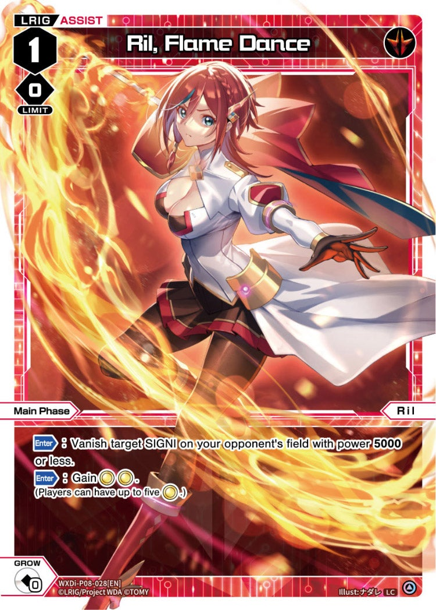

# Ril, Flame Dance

## Thông tin lá

| Trường | Giá trị |
| --- | --- |
| Mã in | WXDi-P08-028[EN] |
| Set | WXDi-P08[EN] |
| Số thứ tự | 028 |
| Loại thẻ | ASSIST LRIG |
| Vị trí | LRIG Deck |
| Số bản | — (set booster, không áp dụng) |
| Màu | Đỏ |
| Độ hiếm | LC,LC(P) |
| Minh họa | ナダレ |
| Level | 1 |
| Limit | 0 |
| Power | 0 |
| LRIG type / Class | Ril |
| Team / Master | — |
| Cost | — |
| Grow cost | 《C》×０ |
| Use timing | Main Phase |
| Life Burst | Không |

## Card text chính thức

[Enter]: Vanish target SIGNI on your opponent's field with power 5000 or less.
[Enter]: Gain {Coin Icon} {Coin Icon}.
(Players can have up to five {Coin Icon}.)

## Power text / Life Burst

—

## Ghi chú minh họa
Artist: ナダレ. Ảnh LC được tải từ Card List tiếng Anh.

## FAQ chính thức

**Q. Does the [Enter] ability must trigger?**
A. Yes, the [Enter] ability without cost is must triggered. If there are SIGNI with power 5000 and power 8000 on your opponent's field, you must target the SIGNI with power 5000 to vanish it.

**Q. May I gain coins with the second [Enter] ability when I have four coins?**
A. Yes, in that case, you can gain one more coin and have a total of five coins.

## Ảnh biến thể

- [LC(P)](../images/WXDi-P08-028P-EN.jpg)

## Nguồn
[Card List/FAQ chính thức](https://www.takaratomy.co.jp/products/en.wixoss/card/card.html?card_no=WXDi-P08-028%5BEN%5D ) · [Ảnh thẻ](https://www.takaratomy.co.jp/products/en.wixoss/card/thumb/WXDi-P08-028%5BEN%5D.jpg)
