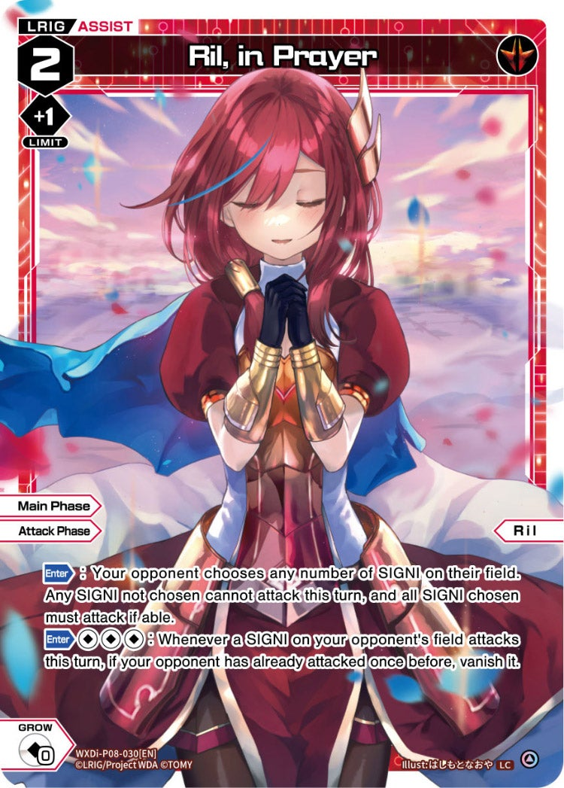

# Ril, in Prayer

## Thông tin lá

| Trường | Giá trị |
| --- | --- |
| Mã in | WXDi-P08-030[EN] |
| Set | WXDi-P08[EN] |
| Số thứ tự | 030 |
| Loại thẻ | ASSIST LRIG |
| Vị trí | LRIG Deck |
| Số bản | — (set booster, không áp dụng) |
| Màu | Đỏ |
| Độ hiếm | LC,LC(P) |
| Minh họa | はしもとなおや |
| Level | 2 |
| Limit | ＋１ |
| Power | 0 |
| LRIG type / Class | Ril |
| Team / Master | — |
| Cost | — |
| Grow cost | 《C》×０ |
| Use timing | Main Phase / Attack Phase |
| Life Burst | Không |

## Card text chính thức

[Enter]: Your opponent chooses any number of SIGNI on their field. Any SIGNI not chosen cannot attack this turn, and all SIGNI chosen must attack if able.
[Enter] {Colorless} {Colorless} {Colorless}: Whenever a SIGNI on your opponent's field attacks this turn, if your opponent has already attacked once before, vanish it.

## Power text / Life Burst

—

## Ghi chú minh họa
Artist: はしもとなおや. Ảnh LC được tải từ Card List tiếng Anh.

## FAQ chính thức

**Q. If my opponent chooses a SIGNI by the first [Enter] ability, and then another SIGNI put on my opponent's field, may that SIGNI attack?**
A. No, it cannot attack even if another SIGNI is newly on the field because it can only attack the chosen SIGNI and no others.

**Q. In the case of the second [Enter] ability, if the same upped SIGNI has attacked twice or more, is it vanished? And what happens if two different SIGNI attack once each?**
A. Both will be vanished. Even if it's the same SIGNI attacking multiple times or if it's two SIGNI attacking once each, they are both considered as a second attack or more by your opponent, so they will be vanished.

**Q. If the first [Enter] ability triggers and my opponent chooses one of their SIGNI, do they need to attack it again if it becomes upped after attacking?**
A. Yes, it must attack again. The SIGNI that is forced to attack cannot end the SIGNI Attack Step while it is still able to attack.

**Q. May I choose to trigger and resolve the second [Enter] ability after seeing how many SIGNI my opponent chooses by the first [Enter] ability?**
A. Yes, you can. Each [Enter] ability can be triggered in any order you like. After resolving the first [Enter] ability, you can choose not to pay the cost and trigger the second [Enter] ability based on the result of the first one.

## Ảnh biến thể

- [LC(P)](../images/WXDi-P08-030P-EN.jpg)

## Nguồn
[Card List/FAQ chính thức](https://www.takaratomy.co.jp/products/en.wixoss/card/card.html?card_no=WXDi-P08-030%5BEN%5D ) · [Ảnh thẻ](https://www.takaratomy.co.jp/products/en.wixoss/card/thumb/WXDi-P08-030%5BEN%5D.jpg)
