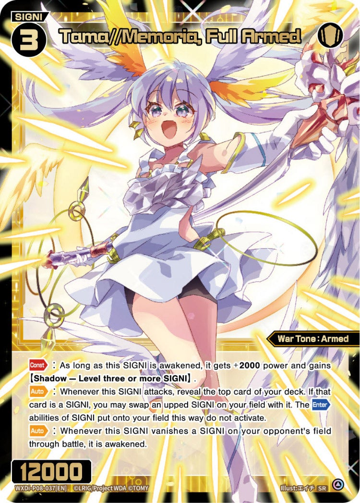

# Tama//Memoria, Full Armed

## Thông tin lá

| Trường | Giá trị |
| --- | --- |
| Mã in | WXDi-P08-037[EN] |
| Set | WXDi-P08[EN] |
| Số thứ tự | 037 |
| Loại thẻ | SIGNI |
| Vị trí | Main Deck |
| Số bản | — (set booster, không áp dụng) |
| Màu | Trắng |
| Độ hiếm | SR,SRP |
| Minh họa | エイチ |
| Level | 3 |
| Limit | — |
| Power | 12000 |
| LRIG type / Class | War Tone：Armed |
| Team / Master | — |
| Cost | — |
| Grow cost | — |
| Use timing | — |
| Life Burst | Không |

## Card text chính thức

[Constant]: As long as this SIGNI is awakened, it gets +2000 power and gains 【Shadow — Level three or more SIGNI】.
[Auto]: Whenever this SIGNI attacks, reveal the top card of your deck. If that card is a SIGNI, you may swap an upped SIGNI on your field with it. The [Enter] abilities of SIGNI put onto your field this way do not activate.
[Auto]: Whenever this SIGNI vanishes a SIGNI on your opponent's field through battle, it is awakened.

## Power text / Life Burst

—

## Ghi chú minh họa
Artist: エイチ. Ảnh SR được tải từ Card List tiếng Anh.

## FAQ chính thức

**Q. What happens with the swapping when I revealed the top card of my deck with this SIGNI's [Aut] ability after it attacked, but it was a SIGNI that cannot be put onto the field due to being over the limit or other reasons?**
A. If either card cannot move, then no swapping occurs and neither card will be moved.

**Q. If this SIGNI's [Auto] ability reveals a card with [Rise] from the top of my deck after it attacked, may that SIGNI be put onto the field by swapping?**
A. If a SIGNI with [Rise] is put onto the field, it is placed on top of a SIGNI in the SIGNI zone. However, if you try to put it onto the field with swapping, there will be no SIGNI that can be placed below it in the destination SIGNI zone. As a result, the swapping cannot occur, and nothing happens. However, 《Cu Chulainn, Crimson General Queen》 is put onto your field with SIGNI from your trash underneath it, so it can be put onto the field.

## Ảnh biến thể

- [SRP](../images/WXDi-P08-037P-EN.jpg)

## Nguồn
[Card List/FAQ chính thức](https://www.takaratomy.co.jp/products/en.wixoss/card/card.html?card_no=WXDi-P08-037%5BEN%5D ) · [Ảnh thẻ](https://www.takaratomy.co.jp/products/en.wixoss/card/thumb/WXDi-P08-037%5BEN%5D.jpg)
