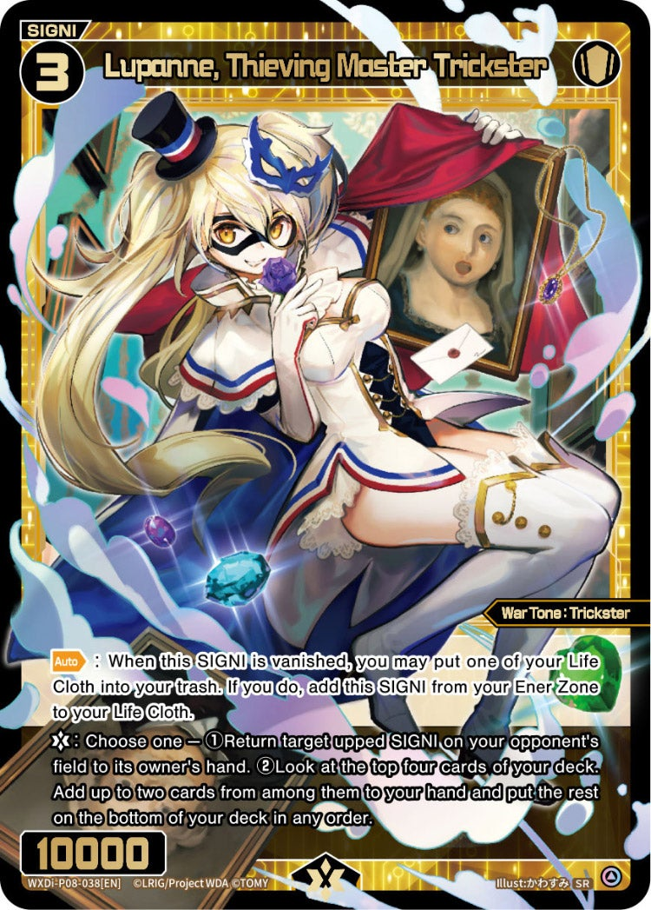

# Lupanne, Thieving Master Trickster

## Thông tin lá

| Trường | Giá trị |
| --- | --- |
| Mã in | WXDi-P08-038[EN] |
| Set | WXDi-P08[EN] |
| Số thứ tự | 038 |
| Loại thẻ | SIGNI |
| Vị trí | Main Deck |
| Số bản | — (set booster, không áp dụng) |
| Màu | Trắng |
| Độ hiếm | SR,SRP |
| Minh họa | かわすみ |
| Level | 3 |
| Limit | — |
| Power | 10000 |
| LRIG type / Class | War Tone：Trickster |
| Team / Master | — |
| Cost | — |
| Grow cost | — |
| Use timing | — |
| Life Burst | Có |

## Card text chính thức

[Auto]: When this SIGNI is vanished, you may put one of your Life Cloth into your trash. If you do, add this SIGNI from your Ener Zone to your Life Cloth.

## Power text / Life Burst

Choose one — ①Return target upped SIGNI on your opponent's field to its owner's hand. ②Look at the top four cards of your deck. Add up to two cards from among them to your hand and put the rest on the bottom of your deck in any order.

## Ghi chú minh họa
Artist: かわすみ. Ảnh SR được tải từ Card List tiếng Anh.

## FAQ chính thức

— (không có FAQ riêng cho mã này trên trang FAQ tiếng Anh.)

## Ảnh biến thể

- [SRP](../images/WXDi-P08-038P-EN.jpg)

## Nguồn
[Card List/FAQ chính thức](https://www.takaratomy.co.jp/products/en.wixoss/card/card.html?card_no=WXDi-P08-038%5BEN%5D ) · [Ảnh thẻ](https://www.takaratomy.co.jp/products/en.wixoss/card/thumb/WXDi-P08-038%5BEN%5D.jpg)
