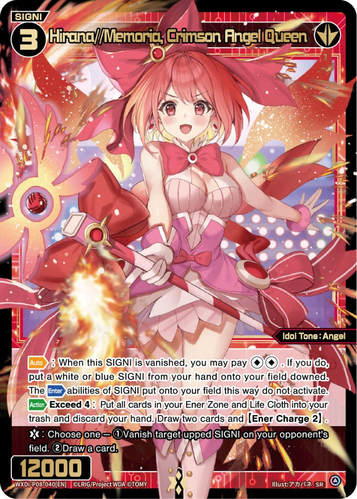

# Hirana//Memoria, Crimson Angel Queen

## Thông tin lá

| Trường | Giá trị |
| --- | --- |
| Mã in | WXDi-P08-040[EN] |
| Set | WXDi-P08[EN] |
| Số thứ tự | 040 |
| Loại thẻ | SIGNI |
| Vị trí | Main Deck |
| Số bản | — (set booster, không áp dụng) |
| Màu | Đỏ |
| Độ hiếm | SR,SRP |
| Minh họa | アカバネ |
| Level | 3 |
| Limit | — |
| Power | 12000 |
| LRIG type / Class | Idol Tone：Angel |
| Team / Master | — |
| Cost | — |
| Grow cost | — |
| Use timing | — |
| Life Burst | Có |

## Card text chính thức

[Auto]: When this SIGNI is vanished, you may pay {Colorless} {Colorless}. If you do, put a white or blue SIGNI from your hand onto your field downed. The [Enter] abilities of SIGNI put onto your field this way do not activate.
[Action] Exceed 4: Put all cards in your Ener Zone and Life Cloth into your trash and discard your hand. Draw two cards and 【Ener Charge 2】.

## Power text / Life Burst

Choose one — ①Vanish target upped SIGNI on your opponent's field. ②Draw a card.

## Ghi chú minh họa
Artist: アカバネ. Ảnh SR được tải từ Card List tiếng Anh.

## FAQ chính thức

**Q. May the Ener cost of the [Auto] ability be paid with this SIGNI that has been vanished and placed in the Ener zone?**
A. Yes, you may pay the Ener cost of this [Auto] ability, including this SIGNI that has been vanished and placed in the Ener zone. The ability will trigger after it has been vanished and placed in the Ener zone, and the remaining effect will be processed normally even in this case.

**Q. May this [Action] ability be used even if there are no cards in the Ener zone or Life Cloth, or in my hand?**
A. Yes, it can be used. The cost of the [Action] ability is only Exceed 4, and everything after the ":" is the effect. Therefore, even if there is no place to put the card and cannot be placed in the trash, other effects will still be processed.

## Ảnh biến thể

- [SRP](../images/WXDi-P08-040P-EN.jpg)

## Nguồn
[Card List/FAQ chính thức](https://www.takaratomy.co.jp/products/en.wixoss/card/card.html?card_no=WXDi-P08-040%5BEN%5D ) · [Ảnh thẻ](https://www.takaratomy.co.jp/products/en.wixoss/card/thumb/WXDi-P08-040%5BEN%5D.jpg)
