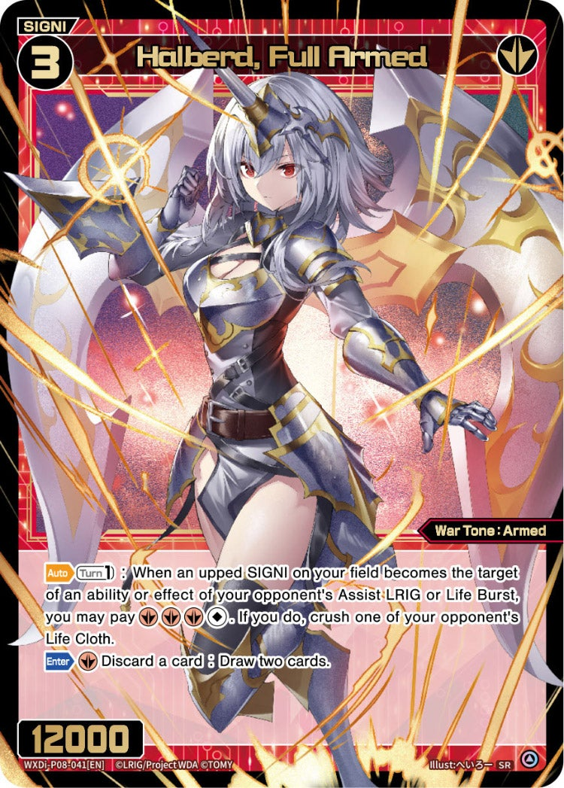

# Halberd, Full Armed

## Thông tin lá

| Trường | Giá trị |
| --- | --- |
| Mã in | WXDi-P08-041[EN] |
| Set | WXDi-P08[EN] |
| Số thứ tự | 041 |
| Loại thẻ | SIGNI |
| Vị trí | Main Deck |
| Số bản | — (set booster, không áp dụng) |
| Màu | Đỏ |
| Độ hiếm | SR,SRP |
| Minh họa | へいろー |
| Level | 3 |
| Limit | — |
| Power | 12000 |
| LRIG type / Class | War Tone：Armed |
| Team / Master | — |
| Cost | — |
| Grow cost | — |
| Use timing | — |
| Life Burst | Không |

## Card text chính thức

[Auto] {1/Turn}: When an upped SIGNI on your field becomes the target of an abilities or effects of your opponent's Assist LRIG or Life Burst, you may pay {Red} {Red} {Red} {Colorless}. If you do, crush one of your opponent's Life Cloth.
[Enter] {Red} Discard a card: Draw two cards.

## Power text / Life Burst

—

## Ghi chú minh họa
Artist: へいろー. Ảnh SR được tải từ Card List tiếng Anh.

## FAQ chính thức

**Q. If this SIGNI is targeted by my opponent's Assist LRIG or Life Burst and vanished as a result, will this SIGNI's [Auto] ability trigger?**
A. Yes, the [Auto] ability of this SIGNI will trigger when it is targeted by your opponent's Assist LRIG or Life Burst and vanished by their effect. It triggers when it becomes the target and resolves after processing the effect of your opponent. Even if this SIGNI itself is not on the field at that time, the triggered ability will still be resolved.

**Q. If my upped SIGNI is targeted by my opponent's Life Burst effect "Down target SIGNI on your opponent's field.", will its [Auto] ability trigger?**
A. Yes, it will trigger. At the time it is targeted, it is the upped SIGNI, so even if it is Downed by that effect, the [Auto] ability of this SIGNI will still trigger.

## Ảnh biến thể

- [SRP](../images/WXDi-P08-041P-EN.jpg)

## Nguồn
[Card List/FAQ chính thức](https://www.takaratomy.co.jp/products/en.wixoss/card/card.html?card_no=WXDi-P08-041%5BEN%5D ) · [Ảnh thẻ](https://www.takaratomy.co.jp/products/en.wixoss/card/thumb/WXDi-P08-041%5BEN%5D.jpg)
