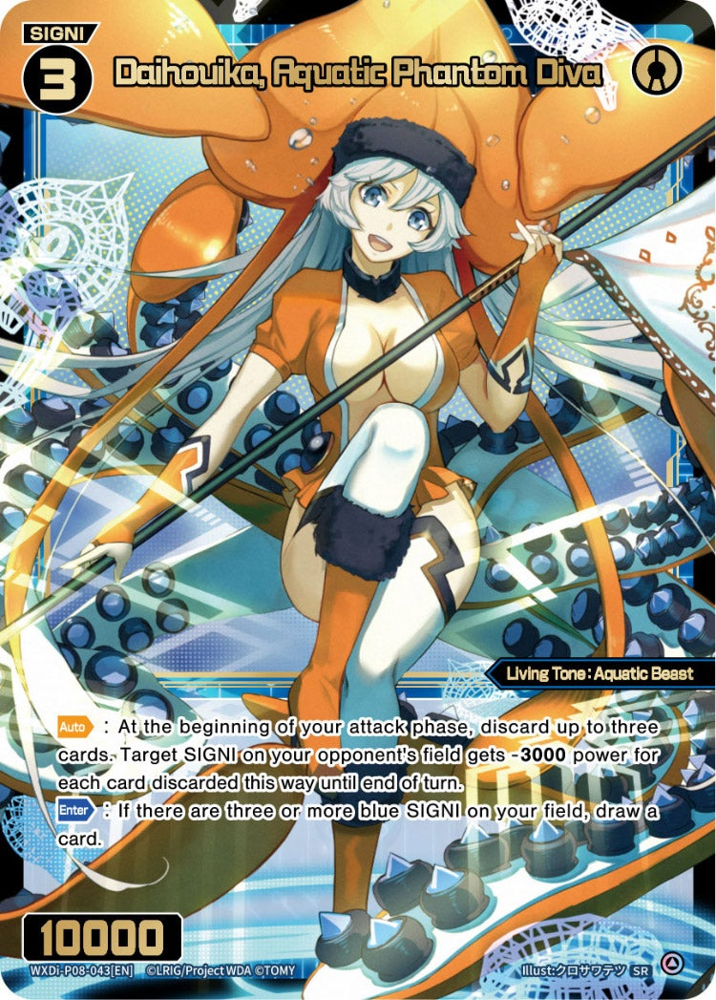

# Daihouika, Aquatic Phantom Diva

## Thông tin lá

| Trường | Giá trị |
| --- | --- |
| Mã in | WXDi-P08-043[EN] |
| Set | WXDi-P08[EN] |
| Số thứ tự | 043 |
| Loại thẻ | SIGNI |
| Vị trí | Main Deck |
| Số bản | — (set booster, không áp dụng) |
| Màu | Xanh dương |
| Độ hiếm | SR,SRP |
| Minh họa | クロサワテツ |
| Level | 3 |
| Limit | — |
| Power | 10000 |
| LRIG type / Class | Living Tone：Aquatic Beast |
| Team / Master | — |
| Cost | — |
| Grow cost | — |
| Use timing | — |
| Life Burst | Không |

## Card text chính thức

[Auto]: At the beginning of your attack phase, discard up to three cards. Target SIGNI on your opponent's field gets -3000 power for each card discarded this way until end of turn.
[Enter]: If there are three or more blue SIGNI on your field, draw a card.

## Power text / Life Burst

—

## Ghi chú minh họa
Artist: クロサワテツ. Ảnh SR được tải từ Card List tiếng Anh.

## FAQ chính thức

**Q. Do SIGNI with multiple colors including blue such as 《Water Buffalo, Phantom Aquatic Beast》 count as blue SIGNI for this [Enter] ability?**
A. Yes, it is counted as blue SIGNI for the purposes of abilities that require a blue SIGNI to be present. 《Water Buffalo, Phantom Aquatic Beast》 is a SIGNI that is both blue and green.

## Ảnh biến thể

- [SRP](../images/WXDi-P08-043P-EN.jpg)

## Nguồn
[Card List/FAQ chính thức](https://www.takaratomy.co.jp/products/en.wixoss/card/card.html?card_no=WXDi-P08-043%5BEN%5D ) · [Ảnh thẻ](https://www.takaratomy.co.jp/products/en.wixoss/card/thumb/WXDi-P08-043%5BEN%5D.jpg)
