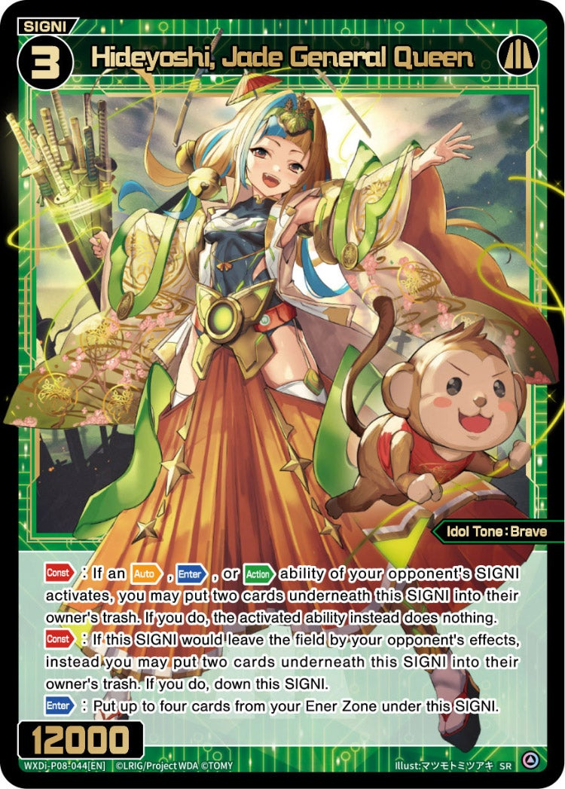

# Hideyoshi, Jade General Queen

## Thông tin lá

| Trường | Giá trị |
| --- | --- |
| Mã in | WXDi-P08-044[EN] |
| Set | WXDi-P08[EN] |
| Số thứ tự | 044 |
| Loại thẻ | SIGNI |
| Vị trí | Main Deck |
| Số bản | — (set booster, không áp dụng) |
| Màu | Xanh lá |
| Độ hiếm | SR,SRP |
| Minh họa | マツモトミツアキ |
| Level | 3 |
| Limit | — |
| Power | 12000 |
| LRIG type / Class | Idol Tone：Brave |
| Team / Master | — |
| Cost | — |
| Grow cost | — |
| Use timing | — |
| Life Burst | Không |

## Card text chính thức

[Constant]: If an [Auto], [Enter], or [Action] ability of your opponent's SIGNI activates, you may put two cards underneath this SIGNI into their owner's trash. If you do, the activated ability instead does nothing.
[Constant]: If this SIGNI would leave the field by your opponent's effects, instead you may put two cards underneath this SIGNI into their owner's trash. If you do, down this SIGNI.
[Enter]: Put up to four cards from your Ener Zone under this SIGNI.

## Power text / Life Burst

—

## Ghi chú minh họa
Artist: マツモトミツアキ. Ảnh SR được tải từ Card List tiếng Anh.

## FAQ chính thức

**Q. When is the timing to put two cards from underneath this SIGNI into the trash with the first [Const] ability?**
A. The timing is just before that ability of your opponent's SIGNI triggers. If there is a cost to be paid, such as with an [Enter] ability, the cost is paid first and then two cards are placed from underneath this SIGNI into the trash.

**Q. May both of this SIGNI's two [Const] abilities be used when there is only one card underneath it?**
A. No, neither abilities can be used and the card cannot be trashed as long as only one card is underneath this SIGNI.

**Q. If the first [Const] ability is used against the [Turn 1] ability of my opponent's SIGNI, may that ability be used again during the same turn?**
A. No, it cannot be used again during the same turn. Although this card nullifies your opponent's [Turn 1] ability, the ability has already been used, so it cannot be used again during the same turn.

**Q. May the second [Const] ability be used when this SIGNI's power is reduced by -12000 due to my opponent's effect, causing its power to become 0?**
A. No, it cannot be used. While the effect that reduces the power can come from your opponent's effect, the vanishment caused by reaching 0 power is considered Rule-based action. This SIGNI will be vanished, and any cards underneath it will be put into your trash by Rule-based action.

**Q. May the second [Const] ability be used on this downed SIGNI?**
A. Yes, it can be used. It will cause the SIGNI to become Down after use, but becoming Down is not a requirement for using this ability, so being in a Downed originally is not a problem.

## Ảnh biến thể

- [SRP](../images/WXDi-P08-044P-EN.jpg)

## Nguồn
[Card List/FAQ chính thức](https://www.takaratomy.co.jp/products/en.wixoss/card/card.html?card_no=WXDi-P08-044%5BEN%5D ) · [Ảnh thẻ](https://www.takaratomy.co.jp/products/en.wixoss/card/thumb/WXDi-P08-044%5BEN%5D.jpg)
