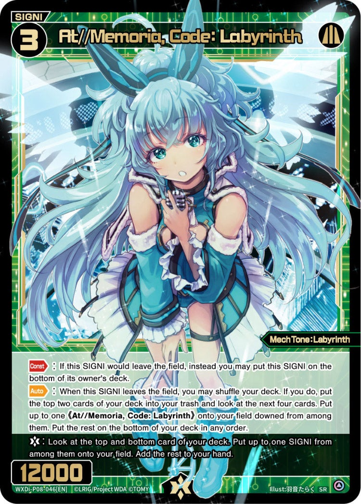

# At//Memoria, Code: Labyrinth

## Thông tin lá

| Trường | Giá trị |
| --- | --- |
| Mã in | WXDi-P08-046[EN] |
| Set | WXDi-P08[EN] |
| Số thứ tự | 046 |
| Loại thẻ | SIGNI |
| Vị trí | Main Deck |
| Số bản | — (set booster, không áp dụng) |
| Màu | Xanh lá |
| Độ hiếm | SR,SRP |
| Minh họa | 羽音たらく |
| Level | 3 |
| Limit | — |
| Power | 12000 |
| LRIG type / Class | Mech Tone：Labyrinth |
| Team / Master | — |
| Cost | — |
| Grow cost | — |
| Use timing | — |
| Life Burst | Có |

## Card text chính thức

[Constant]: If this SIGNI would leave the field, instead you may put this SIGNI on the bottom of its owner's deck.
[Auto]: When this SIGNI leaves the field, you may shuffle your deck. If you do, put the top two cards of your deck into your trash and look at the next four cards. Put up to one 《At//Memoria, Code: Labyrinth》 onto your field downed from among them. Put the rest on the bottom of your deck in any order.

## Power text / Life Burst

Look at the top and bottom card of your deck. Put up to one SIGNI from among them onto your field. Add the rest to your hand.

## Ghi chú minh họa
Artist: 羽音たらく. Ảnh SR được tải từ Card List tiếng Anh.

## FAQ chính thức

**Q. If this SIGNI is put at the bottom of my deck with its [Const] ability when it leaves the field, and its [Auto] ability is triggered, should this SIGNI be shuffled as well?**
A. Yes, it will be shuffled along with the rest of the deck if an [Auto] ability is triggered after it has been put at the bottom of your deck by the [Const] ability.

**Q. What happens when this SIGNI's [Auto] ability triggers and there is only one card left in my deck?**
A. In that case, the one card is put into your trash and the effect ends. After that, since there is no deck, refresh will be performed. It is not possible to process the remaining effect after refreshing.

## Ảnh biến thể

- [SRP](../images/WXDi-P08-046P-EN.jpg)

## Nguồn
[Card List/FAQ chính thức](https://www.takaratomy.co.jp/products/en.wixoss/card/card.html?card_no=WXDi-P08-046%5BEN%5D ) · [Ảnh thẻ](https://www.takaratomy.co.jp/products/en.wixoss/card/thumb/WXDi-P08-046%5BEN%5D.jpg)
