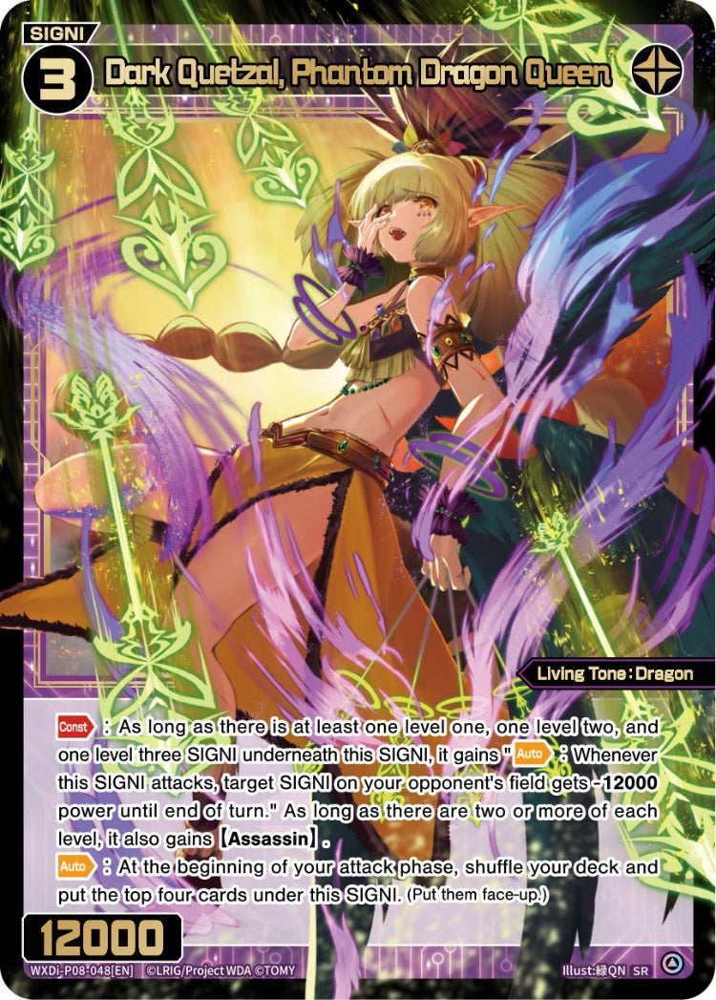

# Dark Quetzal, Phantom Dragon Queen

## Thông tin lá

| Trường | Giá trị |
| --- | --- |
| Mã in | WXDi-P08-048[EN] |
| Set | WXDi-P08[EN] |
| Số thứ tự | 048 |
| Loại thẻ | SIGNI |
| Vị trí | Main Deck |
| Số bản | — (set booster, không áp dụng) |
| Màu | Đen |
| Độ hiếm | SR,SRP |
| Minh họa | 緑QN |
| Level | 3 |
| Limit | — |
| Power | 12000 |
| LRIG type / Class | Living Tone：Dragon |
| Team / Master | — |
| Cost | — |
| Grow cost | — |
| Use timing | — |
| Life Burst | Không |

## Card text chính thức

[Constant]: As long as there is at least one level one, one level two, and one level three SIGNI underneath this SIGNI, it gains "[Auto]: Whenever this SIGNI attacks, target SIGNI on your opponent's field gets -12000 power until end of turn." As long as there are two or more of each level, it also gains 【Assassin】.
[Auto]: At the beginning of your attack phase, shuffle your deck and put the top four cards under this SIGNI. (Put them face-up.)

## Power text / Life Burst

—

## Ghi chú minh họa
Artist: 緑QN. Ảnh SR được tải từ Card List tiếng Anh.

## FAQ chính thức

**Q. Does this SIGNI need at least six cards underneath it to gain the [Assassin] trait through its [Const] Ability?**
A. Yes, you need a total of six cards underneath this SIGNI, with two Level one, two Level two, and two Level three. You will also gain the [Auto] ability for each of them as long as you have one of each.

**Q. What happens if my deck has three or less cards at the beginning of my attack phase?**
A. In that case, all cards in your deck are placed underneath this SIGNI. This is mandatory and cannot be chosen otherwise. After that, since there is no deck, a refresh will be performed.

**Q. When this SIGNI leaves the field, what happens to the cards underneath it?**
A. It will be put into the trash via Rule-based action.

## Ảnh biến thể

- [SRP](../images/WXDi-P08-048P-EN.jpg)

## Nguồn
[Card List/FAQ chính thức](https://www.takaratomy.co.jp/products/en.wixoss/card/card.html?card_no=WXDi-P08-048%5BEN%5D ) · [Ảnh thẻ](https://www.takaratomy.co.jp/products/en.wixoss/card/thumb/WXDi-P08-048%5BEN%5D.jpg)
