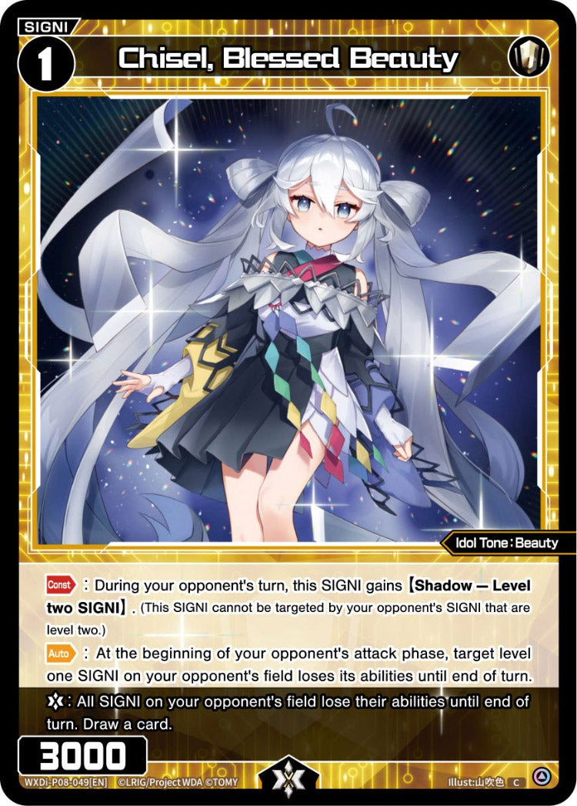

# Chisel, Blessed Beauty

## Thông tin lá

| Trường | Giá trị |
| --- | --- |
| Mã in | WXDi-P08-049[EN] |
| Set | WXDi-P08[EN] |
| Số thứ tự | 049 |
| Loại thẻ | SIGNI |
| Vị trí | Main Deck |
| Số bản | — (set booster, không áp dụng) |
| Màu | Trắng |
| Độ hiếm | C,C(P) |
| Minh họa | 山吹色 |
| Level | 1 |
| Limit | — |
| Power | 3000 |
| LRIG type / Class | Idol Tone：Beauty |
| Team / Master | — |
| Cost | — |
| Grow cost | — |
| Use timing | — |
| Life Burst | Có |

## Card text chính thức

[Constant]: During your opponent's turn, this SIGNI gains 【Shadow — Level two SIGNI】. (This SIGNI cannot be targeted by your opponent's SIGNI that are level two.)
[Auto]: At the beginning of your opponent's attack phase, target level one SIGNI on your opponent's field loses its abilities until end of turn.

## Power text / Life Burst

All SIGNI on your opponent's field lose their abilities until end of turn. Draw a card.

## Ghi chú minh họa
Artist: 山吹色. Ảnh C được tải từ Card List tiếng Anh.

## FAQ chính thức

**Q. If this SIGNI has 【Shadow - Level two SIGNI)】, is it still not targeted by the Life Burst effect of a Level two SIGNI?**
A. Yes, if the Life Burst is triggered by a Level two SIGNI, it is not targeted.

## Ảnh biến thể

- [C(P)](../images/WXDi-P08-049P-EN.jpg)

## Nguồn
[Card List/FAQ chính thức](https://www.takaratomy.co.jp/products/en.wixoss/card/card.html?card_no=WXDi-P08-049%5BEN%5D ) · [Ảnh thẻ](https://www.takaratomy.co.jp/products/en.wixoss/card/thumb/WXDi-P08-049%5BEN%5D.jpg)
