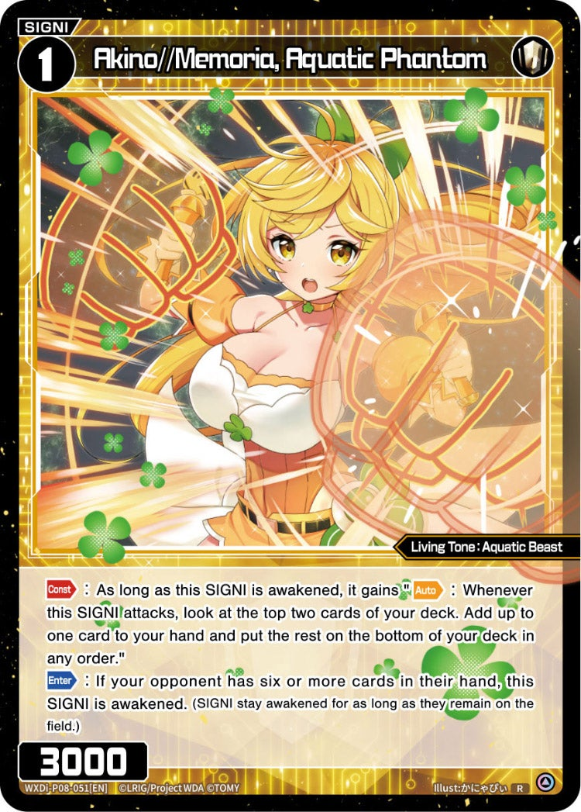

# Akino//Memoria, Water Phantom

## Thông tin lá

| Trường | Giá trị |
| --- | --- |
| Mã in | WXDi-P08-051[EN] |
| Set | WXDi-P08[EN] |
| Số thứ tự | 051 |
| Loại thẻ | SIGNI |
| Vị trí | Main Deck |
| Số bản | — (set booster, không áp dụng) |
| Màu | Trắng |
| Độ hiếm | R,R(P) |
| Minh họa | かにゃぴぃ |
| Level | 1 |
| Limit | — |
| Power | 3000 |
| LRIG type / Class | Living Tone：Aquatic Beast |
| Team / Master | — |
| Cost | — |
| Grow cost | — |
| Use timing | — |
| Life Burst | Không |

## Card text chính thức

[Constant]: As long as this SIGNI is awakened, it gains "[Auto]: Whenever this SIGNI attacks, look at the top two cards of your deck. Add up to one card to your hand and put the rest on the bottom of your deck in any order."
[Enter]: If your opponent has six or more cards in their hand, this SIGNI is awakened. (SIGNI stay awakened for as long as they remain on the field.)

## Power text / Life Burst

—

## Ghi chú minh họa
Artist: かにゃぴぃ. Ảnh R được tải từ Card List tiếng Anh.

## FAQ chính thức

**Q. What happens if my opponent's hand size decreases after this SIGNI awakens?**
A. It remains in the awakened state. Your opponent's hand is only checked when the [Enter] ability is triggered and it will not have any effect thereafter.

## Ảnh biến thể

- [R(P)](../images/WXDi-P08-051P-EN.jpg)

## Nguồn
[Card List/FAQ chính thức](https://www.takaratomy.co.jp/products/en.wixoss/card/card.html?card_no=WXDi-P08-051%5BEN%5D ) · [Ảnh thẻ](https://www.takaratomy.co.jp/products/en.wixoss/card/thumb/WXDi-P08-051%5BEN%5D.jpg)
