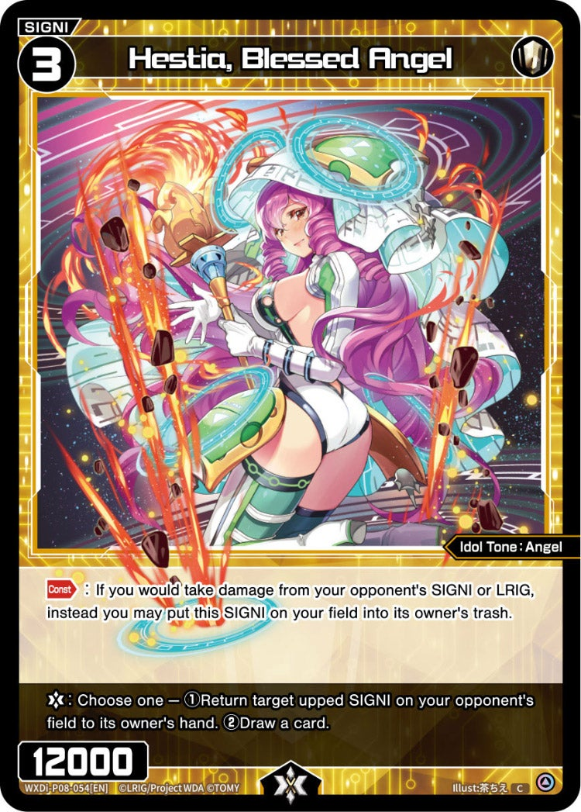

# Hestia, Blessed Angel

## Thông tin lá

| Trường | Giá trị |
| --- | --- |
| Mã in | WXDi-P08-054[EN] |
| Set | WXDi-P08[EN] |
| Số thứ tự | 054 |
| Loại thẻ | SIGNI |
| Vị trí | Main Deck |
| Số bản | — (set booster, không áp dụng) |
| Màu | Trắng |
| Độ hiếm | C,C(P) |
| Minh họa | 茶ちえ |
| Level | 3 |
| Limit | — |
| Power | 12000 |
| LRIG type / Class | Idol Tone：Angel |
| Team / Master | — |
| Cost | — |
| Grow cost | — |
| Use timing | — |
| Life Burst | Có |

## Card text chính thức

[Constant]: If you would take damage from your opponent's SIGNI or LRIG, instead you may put this SIGNI on your field into its owner's trash.

## Power text / Life Burst

Choose one — ①Return target upped SIGNI on your opponent's field to its owner's hand. ②Draw a card.

## Ghi chú minh họa
Artist: 茶ちえ. Ảnh C được tải từ Card List tiếng Anh.

## FAQ chính thức

**Q. If my opponent's SIGNI with [Double Crush] attacks and deals damage, what happens if this SIGNI is put into my trash from the field?**
A. You will not be crushed. [Double Crush] is an ability that crushes two cards when dealing damage through an attack, but the effect of this SIGNI prevents the damage itself.

## Ảnh biến thể

- [C(P)](../images/WXDi-P08-054P-EN.jpg)

## Nguồn
[Card List/FAQ chính thức](https://www.takaratomy.co.jp/products/en.wixoss/card/card.html?card_no=WXDi-P08-054%5BEN%5D ) · [Ảnh thẻ](https://www.takaratomy.co.jp/products/en.wixoss/card/thumb/WXDi-P08-054%5BEN%5D.jpg)
